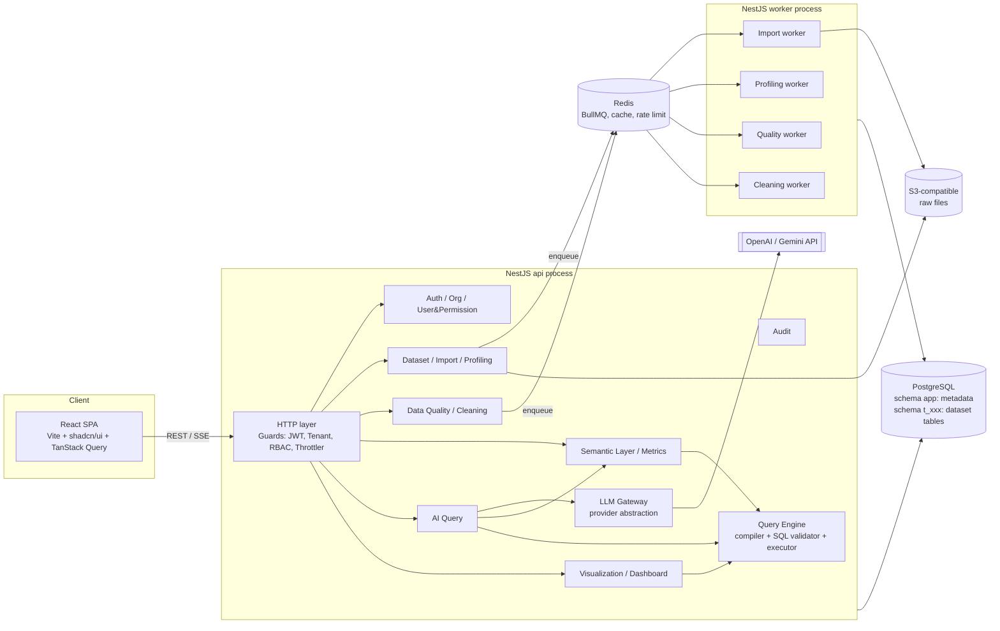

# InsightAI – Kiến trúc tổng thể MVP

> Trạng thái: **Phase 0 – Proposed** (chờ xác nhận). Các quyết định được đánh số `D-xx` nằm trong [DECISIONS.md](DECISIONS.md).
> Tài liệu liên quan: [SEMANTIC_LAYER_DESIGN.md](SEMANTIC_LAYER_DESIGN.md) · [DATA_QUALITY_DESIGN.md](DATA_QUALITY_DESIGN.md) · [DATABASE_DESIGN.md](DATABASE_DESIGN.md) · [DEVELOPMENT_PLAN.md](DEVELOPMENT_PLAN.md)

---

## 1. Phân tích yêu cầu & phạm vi MVP

### 1.1 Bài toán
Doanh nghiệp vừa và nhỏ có dữ liệu nằm rải rác trong CSV/Excel. Vấn đề không phải "thiếu chatbot", mà là:
1. Dữ liệu bẩn → mọi con số phía sau đều sai (**Data Quality**).
2. Mỗi người hiểu "doanh thu" một kiểu → con số không nhất quán (**Semantic Layer**).
3. Người dùng nghiệp vụ không viết được SQL (**AI Analytics** chỉ là giao diện).

Vì vậy luồng giá trị là tuần tự, mỗi tầng phụ thuộc tầng trước:

```
Upload → Profiling → Quality check → Cleaning → (dataset version tin cậy)
      → Semantic model (entity/dimension/measure/metric) → KPI
      → Câu hỏi NL → Semantic Query → SQL tất định → Kết quả + biểu đồ + truy vết
```

### 1.2 Phạm vi MVP (chốt)

| Nhóm | Trong MVP | Ghi chú |
|---|---|---|
| A. Data Management | Upload CSV/XLSX, dataset CRUD, schema & type detection, preview, profiling, import history, dataset status, dataset versions | Một file = một dataset (một sheet với XLSX) |
| B. Data Quality | 5 nhóm check (completeness, uniqueness, validity, consistency, referential integrity), rule cấu hình được, score, report, issue theo cột/bản ghi, gợi ý cleaning, preview, apply, versioning, re-validate | AI chỉ **gợi ý**, không tự sửa |
| C. Semantic Layer & KPI | Semantic model, entity, dimension, measure, metric (simple/ratio/derived), relationship có cardinality, business definition, synonym, access policy, metric versioning, metric engine, KPI API | Không cho người dùng nhập SQL tự do |
| D. AI Q&A & Visualization | NL → Semantic Query (tool calling) → SQL compile → AST validation → permission → execute → giải thích → chart; hội thoại; truy vết | KPI card, table, bar, line, pie |
| Nền tảng | Auth (JWT + refresh), organization, membership, RBAC, audit log, rate limit, multi-tenant isolation | Không billing |

### 1.3 Giả định (cần xác nhận – xem DECISIONS §Open questions)
- A1. Quy mô dataset MVP: ≤ 100 MB/file, ≤ 2 triệu dòng, ≤ 300 cột. Tổng dữ liệu mỗi tenant ở mức GB thấp → PostgreSQL đủ.
- A2. Người dùng là người Việt: hỗ trợ định dạng số `1.234.567,89` và `1,234,567.89`, ngày `dd/MM/yyyy`, tiền tệ VND; giao diện tiếng Việt trước, cấu trúc sẵn i18n.
- A3. Một user có thể thuộc nhiều organization; mỗi request hoạt động trong đúng một organization.
- A4. Không có connector database ngoài (ERP/CRM) trong MVP – nguồn duy nhất là file upload.
- A5. Dữ liệu của tenant không được gửi nguyên bảng cho LLM; chỉ gửi metadata semantic + kết quả đã tổng hợp (có giới hạn dòng).

### 1.4 Ngoài phạm vi
Xem [FUTURE_ROADMAP.md](FUTURE_ROADMAP.md). Đặc biệt: **LLM sinh SQL tự do không nằm trong MVP** (D-03).

---

## 2. Kiến trúc tổng thể

### 2.1 Kiểu kiến trúc
**Modular Monolith (NestJS) + Background Workers** – cùng một codebase, hai entrypoint process (D-01):
- `api` process: REST + SSE, xác thực, điều phối.
- `worker` process: BullMQ consumers (import, profiling, quality, cleaning). Scale ngang độc lập với API.

> Ghi chú cho dev Spring Boot: NestJS module ≈ Spring `@Configuration` + component scan có ranh giới tường minh. Một module chỉ export những provider được khai báo trong `exports`; module khác phải `imports` nó. Đây là cơ chế chính để giữ ranh giới trong monolith – tương tự Spring Modulith. Worker process là một `NestFactory.createApplicationContext(WorkerModule)` (không HTTP), giống một Spring Boot app với `web-application-type=none`.

### 2.2 Sơ đồ thành phần



### 2.3 Hai "plane" dữ liệu trong PostgreSQL (D-04, D-05)

| | Metadata plane | Data plane |
|---|---|---|
| Nội dung | users, orgs, datasets, rules, semantic models, query history… | Bảng dữ liệu thực của người dùng: `t_<org>.ds_<dataset>_v<n>` |
| Schema DB | `app` | Một schema / tenant: `t_<orgShortId>` |
| Truy cập | Prisma (type-safe, migrations) | `pg` driver, SQL do backend sinh ra |
| Cô lập tenant | `organization_id` + app-level guard + PostgreSQL RLS | Schema riêng + **role riêng mỗi tenant** (`t_xxx_reader`, `t_xxx_writer`) |
| Ai ghi | API process | Worker (import/cleaning) dùng role writer; Query Engine dùng role reader |

Lý do lưu dataset thành **bảng PostgreSQL có kiểu thật** thay vì JSONB hoặc file Parquet:
- Semantic Layer và Data Quality đều biên dịch xuống SQL set-based → chạy trên toàn bộ dữ liệu, không load vào RAM Node.js.
- Có thể đánh index cho cột time/khóa, `ANALYZE`, dùng `percentile_cont`, `COUNT(DISTINCT)`.
- Role riêng/tenant cho phép phòng thủ tầng DB: kể cả khi SQL validator có lỗi, query của tenant A **không có quyền** đọc schema tenant B.

### 2.4 Cấu trúc repository (D-02)

```
insightai/
├─ apps/
│  ├─ api/                 # NestJS (2 entrypoint: main.ts, worker.ts)
│  │  ├─ src/modules/<module>/
│  │  ├─ src/platform/     # config, logger, prisma, pg pools, queue, storage, errors
│  │  └─ prisma/           # schema.prisma + migrations
│  └─ web/                 # React + Vite
├─ packages/
│  └─ contracts/           # Zod schemas + TS types dùng chung (Semantic Query IR, DTO, chart spec)
├─ docker/                 # compose: postgres, redis, seaweedfs (S3)
├─ docs/
└─ .github/workflows/
```
- pnpm workspaces. Không dùng Turborepo/Nx trong MVP (2 app + 1 package không cần build orchestration).
- `packages/contracts` là nguồn sự thật cho **Semantic Query IR** và **Chart Spec**: backend validate bằng Zod, frontend dùng cùng type, JSON Schema cho LLM tool calling được sinh từ chính Zod schema → một định nghĩa duy nhất cho 3 nơi.

---

## 3. Backend modules

Mỗi module: `controller` (mỏng) → `service` (business logic) → `repository` (Prisma, luôn nhận `orgId`). Không có generic repository / CQRS / event sourcing.

| # | Module | Trách nhiệm | Phụ thuộc chính |
|---|---|---|---|
| 1 | `auth` | Đăng ký, đăng nhập, Argon2id, JWT access + refresh rotation, logout | user |
| 2 | `organization` | CRUD org, tạo tenant schema + roles khi tạo org (transaction + job bù) | platform/db-admin |
| 3 | `iam` (User & Permission) | membership, roles, permission check (`@RequirePermission`) | – |
| 4 | `dataset` | Dataset, version, column, status machine, preview | storage, data-plane |
| 5 | `import` | Upload (presigned hoặc multipart), import_jobs, parser CSV/XLSX, type inference | dataset, queue |
| 6 | `profiling` | Thống kê cột trên version | dataset |
| 7 | `quality` | Rule, check run, score, issue, report | dataset, expression |
| 8 | `cleaning` | Suggestion, operation, preview, apply → version mới, trigger re-validate | dataset, quality, expression |
| 9 | `semantic` | Model, entity, dimension, measure, relationship, policy, synonym, semantic validation | dataset, expression |
| 10 | `metrics` | Metric + metric version, KPI API, gọi Query Engine | semantic, query-engine |
| 11 | `ai-query` | Conversation, pipeline NL → IR → kết quả, SSE | semantic, query-engine, llm |
| 12 | `visualization` | Chart spec rules, dashboards, widgets | query-engine |
| 13 | `audit` | Ghi audit log (sync, trong transaction nghiệp vụ khi cần) | – |
| – | `query-engine` (shared kernel) | Semantic Query compiler, SQL AST validator, executor (timeout, row limit, role) | semantic (read-only) |
| – | `expression` (shared kernel) | DSL biểu thức hạn chế → AST → SQL có tham số. Dùng chung bởi quality, cleaning, semantic | – |
| – | `llm` (platform) | `LlmProvider` interface, adapter OpenAI/Gemini, retry, token accounting, redaction | – |

Quy tắc phụ thuộc: không có vòng; `ai-query` là module duy nhất gọi `llm` trong MVP (ngoài `cleaning` gọi để gợi ý – tùy chọn). `query-engine` là **cửa duy nhất** chạy SQL trên data plane cho mục đích đọc phân tích.

---

## 4. Các luồng chính

### 4.1 Import

```mermaid
sequenceDiagram
  participant U as User
  participant API
  participant S3
  participant Q as BullMQ
  participant W as Import Worker
  participant PG
  U->>API: POST /datasets/:id/imports (multipart, ≤100MB)
  API->>API: validate size, extension, magic bytes
  API->>S3: put raw file (key = org/dataset/sha256)
  API->>PG: import_job(PENDING), data_source
  API->>Q: add(job, jobId = importJobId)
  W->>PG: claim job (PENDING→RUNNING, optimistic)
  W->>S3: stream file
  W->>PG: COPY → staging table (tất cả cột TEXT, + _row_id)
  W->>PG: type inference (sample + full-scan regex counts)
  W->>PG: CREATE TABLE ds_x_v1 AS SELECT safe_cast(...) ; DROP staging
  W->>PG: dataset_version, dataset_columns, job SUCCEEDED
  W->>Q: enqueue profiling + quality check
```
- Giữ nguyên **raw file** trên S3 (bất biến) → có thể re-import với tùy chọn khác (delimiter, encoding, locale).
- Giá trị không cast được thành `NULL` trong bảng typed; bảng staging được giữ lại dưới tên `ds_x_raw` (toàn TEXT, bất biến) để Validity check so sánh và UI hiển thị "giá trị gốc". Chi tiết ở DATA_QUALITY_DESIGN §3.
- Idempotency: `jobId` BullMQ = `import_job.id`; worker chuyển trạng thái bằng `UPDATE … WHERE status='PENDING'`; bảng staging có tên tất định và được `DROP IF EXISTS` khi retry (chỉ bảng staging do chính job sở hữu).

### 4.2 Quality & Cleaning
Xem DATA_QUALITY_DESIGN.md. Tóm tắt: rule (JSON) → compile SQL → chạy trên version → kết quả theo rule + mẫu bản ghi lỗi → score. Cleaning = danh sách operation có thứ tự → preview trên mẫu → apply sinh **version mới** (copy-on-write) → tự động re-validate.

### 4.3 AI Question Answering

```
Question
 → [1] Intent & Semantic Mapping (LLM tool call, catalog đã lọc theo quyền)
 → [2] Semantic Query IR (Zod validate)        ← LLM dừng ở đây, không viết SQL
 → [3] Query Planning (join graph, fan-out check, time grain)
 → [4] SQL Generation (tất định, tham số hóa)
 → [5] SQL AST Validation (parser Postgres thật, allowlist node/bảng/hàm)
 → [6] Permission Validation (access policy → inject row filter; member access)
 → [7] Execute (role tenant reader, READ ONLY tx, statement_timeout, LIMIT)
 → [8] Result Interpretation (LLM viết narrative với placeholder, backend điền số)
 → [9] Chart Spec (rule-based từ hình dạng kết quả; LLM chỉ được đề xuất trong tập cho phép)
 → Response + provenance (metric_version_ids, dataset_version_ids, sql, query_history_id)
```
Chi tiết ở SEMANTIC_LAYER_DESIGN §6–§8. Hai điểm then chốt:
- **LLM không sinh SQL**; nó chọn metric/dimension/filter từ catalog bằng tool calling. Bước [3]–[5] tất định → câu hỏi khác nhau cùng nghĩa cho ra cùng IR → cùng SQL → cùng số.
- **LLM không sinh số**; narrative dùng placeholder `{{value:row0.total_revenue}}`, backend render từ result set.

Khi IR không xác định được (không tìm thấy metric, mơ hồ giữa 2 metric, thiếu khoảng thời gian bắt buộc) → LLM gọi tool `ask_clarification` → trả câu hỏi lại cho user, không đoán.

SSE event: `stage` (understanding|planning|executing|explaining), `clarification`, `result`, `narrative_delta`, `done`, `error`.

---

## 5. Cross-cutting

### 5.1 Multi-tenancy
- `TenantContext` (AsyncLocalStorage, tương đương ThreadLocal/RequestScope trong Spring) chứa `userId`, `orgId`, `roles`, `permissions`. Được set bởi guard sau khi verify JWT + kiểm tra membership của `X-Organization-Id` (hoặc org trong path).
- Repository bắt buộc nhận `orgId`; Prisma client extension tự `SET LOCAL app.org_id` trong transaction để RLS áp dụng (D-06).
- Data plane: tên schema/role lấy từ `organizations.data_schema` (do server sinh, không bao giờ từ input).
- FK giữa các bảng tenant dùng composite `(organization_id, id)` ở những quan hệ nhạy cảm để DB chặn tham chiếu chéo tenant (DATABASE_DESIGN §4).

### 5.2 Bảo mật
| Mối đe dọa | Biện pháp |
|---|---|
| Lộ mật khẩu | Argon2id (`argon2` package), tham số OWASP; không log body auth |
| Token bị đánh cắp | Access JWT 15 phút; refresh token opaque, lưu hash, rotation + reuse detection (revoke cả family) |
| Truy cập chéo tenant | Guard membership + RLS metadata + schema/role riêng ở data plane + composite FK |
| SQL injection | Không nối chuỗi từ input; identifier lấy từ metadata đã validate và quote bằng `pg-format`/escapeIdentifier; giá trị luôn là `$n` params; AST validation |
| LLM prompt injection (dữ liệu/câu hỏi chứa lệnh) | LLM không có quyền gì ngoài trả IR; IR được validate bằng Zod + semantic catalog; tên cột/giá trị dữ liệu được đưa vào prompt dưới dạng dữ liệu có đánh dấu |
| Query nặng / DoS | statement_timeout, row limit, rate limit theo user & org (Redis), giới hạn số câu hỏi AI/ngày/org |
| File độc hại | Allowlist `.csv/.xlsx`, kiểm tra magic bytes, giới hạn kích thước, giới hạn số dòng/cột, không thực thi macro (.xlsm bị từ chối), zip-bomb guard cho XLSX (giới hạn uncompressed size) |
| Lộ secret | Config qua env + `@nestjs/config` + Zod validate khi boot; pino redaction cho `authorization`, `password`, `apiKey`, `token` |
| Mất dấu vết | audit_logs cho mọi thao tác ghi quan trọng (publish metric, apply cleaning, đổi quyền) |

### 5.3 Reliability
- BullMQ: `attempts: 3`, backoff exponential, `jobId` tất định, DB là nguồn sự thật cho trạng thái job (Redis mất dữ liệu vẫn không mất trạng thái). Job "RUNNING" quá hạn được một cron sweeper đánh dấu FAILED/requeue.
- Transaction: thao tác metadata đa bảng (publish metric version, activate dataset version) trong một Prisma transaction. DDL data plane (CREATE TABLE) không thể nằm chung transaction với Prisma → dùng pattern "tạo bảng trước, ghi metadata sau; bảng mồ côi được dọn bởi job reconcile" (chỉ xóa bảng không có metadata tham chiếu và quá 24h – không đụng dữ liệu người dùng đã đăng ký).
- Health: `/health/live`, `/health/ready` (Postgres, Redis, S3) bằng `@nestjs/terminus`.

### 5.4 Observability
- pino (`nestjs-pino`) JSON log, `requestId`/`orgId`/`userId` trong mọi dòng log, redaction.
- Mỗi AI query lưu: latency từng stage, token usage, model, kết quả validate → đủ để debug và đo accuracy.
- OpenTelemetry để sau MVP.

### 5.5 Error handling
Một `AppError` hierarchy (`ValidationError`, `NotFoundError`, `ForbiddenError`, `ConflictError`, `QueryRejectedError`, `ExternalServiceError`) + global exception filter → response chuẩn RFC 7807 (`application/problem+json`) với `code` ổn định để frontend i18n.

---

## 6. Frontend

- React + TS + Vite, React Router (data router), TanStack Query cho server state, Zustand **không** dùng (state client ít; URL + Query đủ).
- shadcn/ui + Tailwind; dark mode qua class `dark` + CSS variables của shadcn (chi phí thấp → đưa vào MVP).
- Chart: Recharts thông qua shadcn `Chart` component (D-09) – theme thống nhất với UI. Frontend chỉ render `ChartSpec` (type ∈ {kpi, table, bar, line, pie}) đã được backend validate.
- Form: React Hook Form + Zod (dùng schema từ `packages/contracts`).
- Bảng dữ liệu lớn: TanStack Table + server-side pagination; virtualization cho preview.
- Màn hình MVP: Auth · Org switcher · Datasets (list, upload, detail: preview/schema/profile/versions/imports) · Quality (rules, report, issues, cleaning wizard) · Semantic (model editor, metric editor + test query) · Ask (chat + chart + provenance panel) · Dashboards · Settings (members, roles) · Audit log.

---

## 7. Deployment (MVP)

- Docker Compose dev: postgres:16, redis:7, seaweedfs (S3 API); api, worker, web chạy trên host.
- Production MVP: 1 VM/container platform: api ×N, worker ×M, managed PostgreSQL, managed Redis, S3. Web build tĩnh qua CDN/nginx.
- CI (GitHub Actions): lint, typecheck, unit test, integration test với service containers Postgres/Redis, build Docker image.

## 8. Rủi ro kỹ thuật chính

| Rủi ro | Mức | Giảm thiểu |
|---|---|---|
| Fan-out / double counting khi join | Cao | Planner chỉ cho phép join theo hướng many-to-one từ entity của measure; multi-entity → aggregate từng nguồn rồi join (SEMANTIC §6.3). Test bằng bộ fixture cố ý có fan-out |
| Type inference sai với dữ liệu VN (dấu thập phân, ngày) | Cao | Locale do user chọn khi import + thống kê tỉ lệ match từng pattern; user override kiểu cột trước khi tạo bảng typed |
| Prisma + RLS (cần `SET LOCAL` trong transaction mỗi query) | Trung bình | Spike ở Phase 1; fallback: app-level scoping bắt buộc + RLS chỉ cho data plane |
| Số lượng bảng tăng nhanh (mỗi version một bảng) | Trung bình | Retention: giữ N version gần nhất + version gốc; bảng cũ archive về S3 (Parquet) sau MVP |
| LLM mapping sai metric | Trung bình | Synonym + mô tả + few-shot; hiển thị "đã hiểu là: Metric X, theo tháng, 2026" để user xác nhận; bộ eval câu hỏi chuẩn |
| Parser SQL cho Node (độ chính xác AST Postgres) | Trung bình | Dùng `libpg-query` (parser thật của Postgres, có bản WASM); spike Phase 5 |
| XLSX lớn tốn RAM | Trung bình | `exceljs` streaming reader; giới hạn kích thước giải nén |
