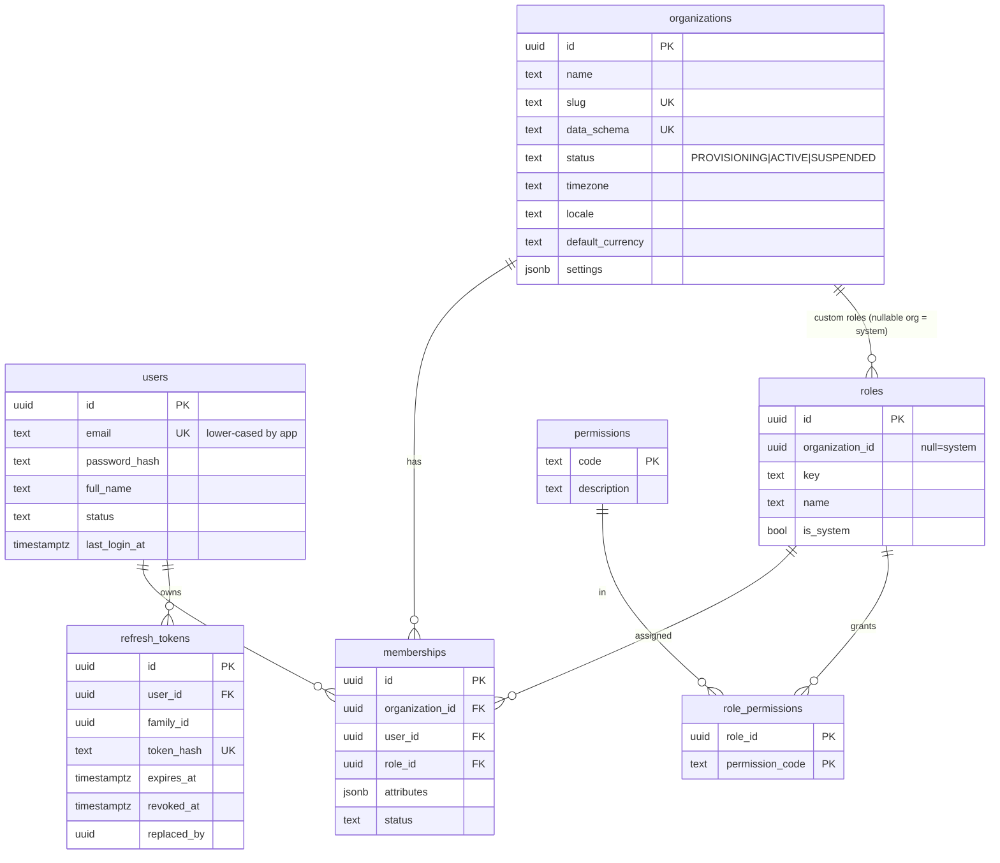
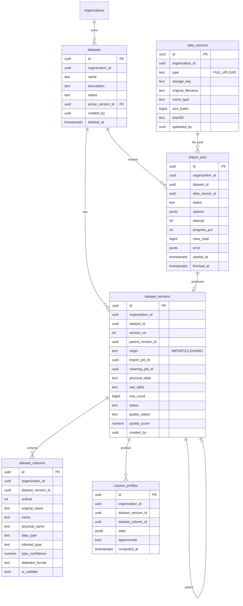
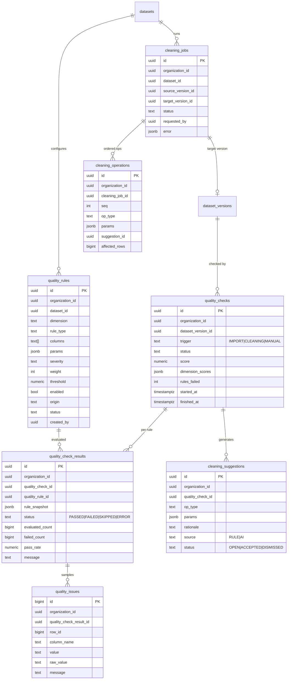
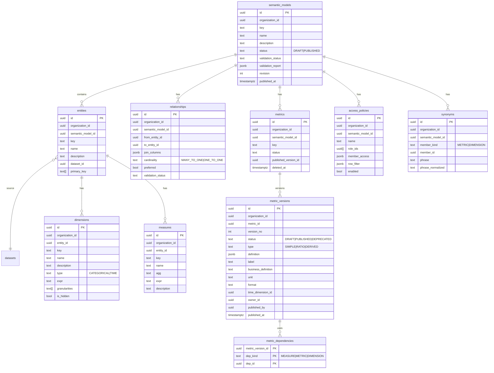
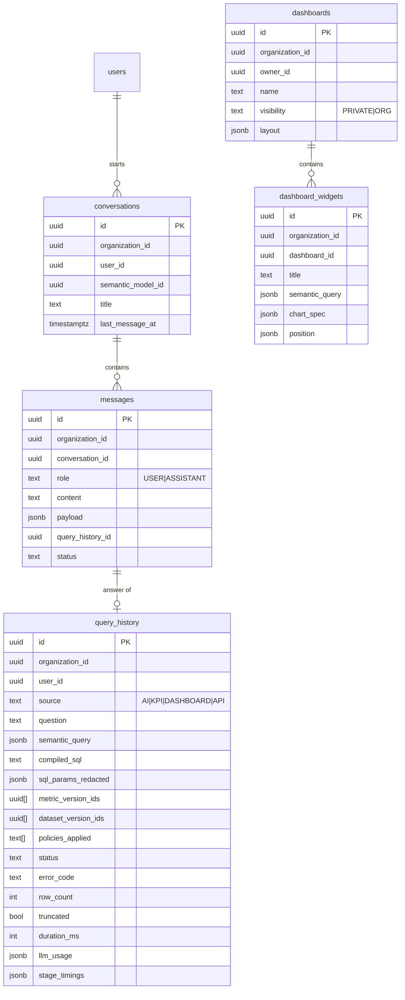

# InsightAI – Database Design

> Trạng thái: **Phase 0 – Proposed**. Migration chỉ được tạo từ Phase 1/2 sau khi tài liệu này được xác nhận. Quyết định liên quan: D-04, D-05, D-06, D-13.

## 1. Quy ước chung

| Quy ước | Giá trị |
|---|---|
| DB | PostgreSQL 16; extensions: `pgcrypto`, `citext`, `pg_trgm`, `unaccent` |
| Schema | `app` (metadata, Prisma quản lý) · `t_<orgShortId>` (data plane, mỗi tenant một schema, tạo bằng code có kiểm soát) |
| Primary key | `uuid` v7 sinh phía app (time-ordered → index B-tree tốt hơn v4) |
| Tenant column | `organization_id uuid NOT NULL` trên **mọi** bảng nghiệp vụ, kể cả bảng con (phục vụ RLS + index) |
| Thời gian | `timestamptz`, cột `created_at`, `updated_at`; xóa mềm `deleted_at` chỉ ở dataset, semantic_model, metric, dashboard |
| Enum | PostgreSQL enum qua Prisma cho trạng thái ổn định; `text + CHECK` cho tập dễ mở rộng (rule type) |
| JSON | `jsonb` chỉ cho cấu hình có schema Zod (params, definition, profile) – không dùng JSONB thay cho quan hệ |
| Naming | snake_case số nhiều; Prisma model PascalCase với `@@map` |

## 2. ERD

### 2.1 Core / IAM


- `memberships`: UNIQUE `(organization_id, user_id)` → MVP một role/user/org (đủ đơn giản; nhiều role → roadmap).
- System roles: `owner, admin, analyst, viewer`. Permission codes dạng `resource:action` (`dataset:write`, `quality:apply_cleaning`, `semantic:publish`, `semantic:query`, `member:manage`, `audit:read` …). Ma trận role–permission seed bằng migration.
- `refresh_tokens`: phát hiện tái sử dụng → revoke toàn bộ `family_id`.

### 2.2 Data Management



Trạng thái:
- `datasets.status`: `DRAFT` (chưa có version) → `PROCESSING` → `READY` | `ERROR`; `ARCHIVED`.
- `import_jobs.status`: `PENDING → RUNNING → SUCCEEDED | FAILED | CANCELLED`.
- `dataset_versions.status`: `CREATING → READY | FAILED`; `quality_status`: `UNCHECKED | PASSED | WARNING | FAILED`.

Ràng buộc/index:
- `dataset_versions` UNIQUE `(dataset_id, version_no)`; UNIQUE `(organization_id, physical_table)`.
- `dataset_columns` UNIQUE `(dataset_version_id, name)`, UNIQUE `(dataset_version_id, ordinal)`.
- `datasets` UNIQUE `(organization_id, name) WHERE deleted_at IS NULL`.
- `import_jobs` INDEX `(organization_id, dataset_id, created_at DESC)` – import history.
- `data_sources` INDEX `(organization_id, sha256)` – cảnh báo file trùng.
- `datasets.active_version_id` FK tới `dataset_versions` (deferrable, vì tạo vòng); phải thuộc cùng dataset – kiểm tra trong service + trigger.

### 2.3 Data Quality & Cleaning


- `quality_check_results.rule_snapshot`: bản sao rule tại thời điểm chạy → report cũ vẫn đúng khi rule bị sửa.
- `quality_issues`: chỉ lưu **mẫu** (≤ 500/rule/check) → bảng không phình theo số dòng dữ liệu. `bigint identity` vì số lượng lớn, không cần uuid. INDEX `(quality_check_result_id, row_id)`, INDEX `(organization_id, quality_check_result_id, column_name)`.
- `quality_checks` INDEX `(dataset_version_id, created_at DESC)`.
- `cleaning_operations` UNIQUE `(cleaning_job_id, seq)`.
- Phase 3b (đã hiện thực): `cleaning_suggestions` **không** tạo bảng – gợi ý tính lại khi hỏi (D-39); `cleaning_jobs` có `table_key`, `attempts`, `started_at/finished_at`; `cleaning_operations` có thêm `removed_rows`; `dataset_versions.cleaning_job_id` UNIQUE; version cleaning dùng chung `raw_table` của import gốc (D-37).
- Ràng buộc: chỉ một `quality_check` RUNNING / version (partial unique index `WHERE status IN ('PENDING','RUNNING')`) → chống chạy trùng.

### 2.4 Semantic Layer


- Key (`entity.key`, `dimension.key`, `metric.key`): `^[a-z][a-z0-9_]{0,62}$`, UNIQUE trong scope cha – đây là tên dùng trong IR.
- `metric_versions`: UNIQUE `(metric_id, version_no)`; **partial UNIQUE `(metric_id) WHERE status = 'PUBLISHED'`** → bảo đảm một định nghĩa chuẩn ở tầng DB. Version đã PUBLISHED bất biến (trigger chặn UPDATE `definition`).
- `metric_dependencies`: tra ngược "metric nào bị ảnh hưởng khi measure/dimension đổi" và phát hiện vòng.
- `synonyms`: `phrase_normalized = lower(unaccent(phrase))`, GIN `gin_trgm_ops` → tìm "doanh thu" ≈ "doanh thu thuần". UNIQUE `(semantic_model_id, phrase_normalized)` – một cụm từ chỉ trỏ tới một member, tránh mơ hồ.
- `entities.dataset_id` trỏ dataset (không trỏ version): luôn dùng `active_version_id`. Đổi active version → kích hoạt semantic validation.

### 2.5 Analytics


- Widget lưu **IR**, không lưu SQL hay kết quả → luôn chạy lại qua compiler với quyền của **người xem** (dashboard ORG không làm lộ dữ liệu ngoài policy của người xem).
- `query_history` INDEX `(organization_id, created_at DESC)`, `(organization_id, user_id, created_at DESC)`. Không lưu result rows (chỉ lưu kết quả gửi kèm message trong `messages.payload` khi cần hiển thị lại hội thoại, có giới hạn 1000 dòng).

### 2.6 Audit

```
audit_logs { bigint id PK identity; uuid organization_id; uuid actor_user_id; text action; text resource_type; uuid resource_id; jsonb changes; inet ip; text user_agent; text request_id; timestamptz created_at }
```
- Append-only: role app chỉ có `INSERT, SELECT` trên bảng này (REVOKE UPDATE/DELETE).
- INDEX `(organization_id, created_at DESC)`, `(organization_id, resource_type, resource_id)`. Partition theo tháng khi > 10M dòng (roadmap).

## 3. Cardinality tóm tắt

| Quan hệ | Cardinality |
|---|---|
| user – organization | N:M qua memberships (1 role/membership) |
| organization – dataset | 1:N |
| dataset – dataset_version | 1:N (đúng 0..1 active) |
| dataset_version – dataset_column | 1:N |
| dataset – quality_rule | 1:N (rule sống theo dataset, áp lên mọi version) |
| dataset_version – quality_check | 1:N |
| quality_check – result – issue | 1:N:N |
| cleaning_job – operation | 1:N có thứ tự; cleaning_job → 0..1 target version |
| semantic_model – entity / relationship / metric / policy | 1:N |
| entity – dataset | N:1 |
| metric – metric_version | 1:N (≤ 1 PUBLISHED) |
| conversation – message | 1:N; message → 0..1 query_history |

## 4. Multi-tenancy & bảo vệ ở tầng DB

1. **RLS trên mọi bảng có `organization_id`** (D-06):
   ```sql
   ALTER TABLE app.datasets ENABLE ROW LEVEL SECURITY;
   ALTER TABLE app.datasets FORCE ROW LEVEL SECURITY;
   CREATE POLICY tenant_isolation ON app.datasets
     USING (organization_id = NULLIF(current_setting('app.org_id', true), '')::uuid)
     WITH CHECK (organization_id = NULLIF(current_setting('app.org_id', true), '')::uuid);
   -- NULLIF bắt buộc: sau khi set_config(..., true) đã chạy trên một connection trong pool, giá trị
   -- trở về '' (không phải NULL) khi transaction kết thúc → ''::uuid gây lỗi (phát hiện ở spike Phase 1).
   ```
   App kết nối bằng role `insightai_app` (không phải owner, `NOBYPASSRLS`). Mọi truy vấn đi qua `PrismaService.runInContext({ organizationId?, userId?, … })`, đặt các setting transaction-local qua `set_config`. **Không có role BYPASSRLS nào được ứng dụng dùng.** Các key context (đã hiện thực ở Phase 2a, migration `20261103120000_iam_audit`):

   | Key | Dùng cho |
   |---|---|
   | `app.org_id` | Dữ liệu tenant |
   | `app.user_id` | `users`, `refresh_tokens`, và membership của chính user ở mọi org (để liệt kê "org của tôi") |
   | `app.login_email` | Login: chỉ thấy đúng 1 user có email đó |
   | `app.refresh_token_hash` | Refresh: chỉ thấy đúng 1 refresh token |
   | `app.invite_token_hash` | Xem/nhận link mời: chỉ thấy đúng 1 invitation |

   Helper `app.ctx_uuid(key)` / `app.ctx_text(key)` bọc `NULLIF(current_setting(key, true), '')`. Bảng `users`: thấy chính mình + thành viên cùng org hiện tại. `audit_logs`: chỉ INSERT/SELECT (không UPDATE/DELETE); sự kiện cấp user (login) có `organization_id` NULL và không đọc được qua API.

   **Lưu ý khi viết code:** `INSERT ... RETURNING` (Prisma `create`) bị kiểm tra theo policy SELECT. Với bảng chỉ-ghi như audit dùng `createMany` (không RETURNING).
2. **Composite FK** cho quan hệ cha–con trong cùng tenant, vd. `dataset_versions (organization_id, dataset_id) → datasets (organization_id, id)` (yêu cầu UNIQUE `(organization_id, id)` trên bảng cha). Ngăn bug ứng dụng tạo con của tenant A trỏ tới cha của tenant B. Áp dụng cho các quan hệ: dataset↔version↔column, rule/check, semantic model↔entity↔dimension/measure, metric↔version, dashboard↔widget.
3. **Data plane**: schema `t_xxx` + role `t_xxx_reader` (SELECT), `t_xxx_writer` (CREATE trên schema). Login role `insightai_analytics` (pool AI/KPI) và `insightai_ingest` (pool worker) là `NOINHERIT`, chỉ có quyền sau khi `SET LOCAL ROLE` sang role của tenant. Giới hạn: chúng là thành viên của mọi role tenant, nên SQL validator vẫn phải chặn `SET`/`set_config` (xem DECISIONS D-06). Tên schema do server sinh từ `organizations.data_schema`, regex `^t_[a-z0-9]{8,12}$`, không bao giờ từ input.
4. **Tạo tenant** (Phase 2a): role `insightai_provisioner` (CREATEROLE + CREATE trên database, NOINHERIT, không đọc được schema `app`) tạo `t_xxx_reader`/`t_xxx_writer`, schema `t_xxx`, GRANT reader→`insightai_analytics`, writer→`insightai_ingest`. Không thể cùng transaction với metadata (khác connection/role) nên: insert org `PROVISIONING` + membership owner → provisioning idempotent (advisory lock theo schema) → `ACTIVE`. Nếu bước giữa lỗi, `TenantGuard` gọi lại provisioning ở request kế tiếp. Schema do provisioner sở hữu; bảng do writer tạo và writer phải `GRANT SELECT` cho reader khi tạo bảng.
5. **Roles hiện có (`apps/api/scripts/bootstrap-db.mjs`)**: `insightai_owner` (sở hữu schema `app`, chạy migration), `insightai_app`, `insightai_analytics`, `insightai_ingest`, `insightai_provisioner`. Tên/mật khẩu lấy từ các connection URL trong `.env`.

## 5. Data plane: bảng dataset

Đã hiện thực ở Phase 2c (migration `20261103140000_data_management`):

```sql
-- dataKey: 10 ký tự sinh khi tạo dataset; tableKey: 8 ký tự sinh cho mỗi import job
CREATE TABLE t_<org>.r_<dataKey>_<tableKey> (_row_id bigint PRIMARY KEY, c_1 text, c_2 text, …); -- raw, bất biến
CREATE TABLE t_<org>.v_<dataKey>_<tableKey> (_row_id bigint PRIMARY KEY, c_1 numeric, c_2 date, …); -- typed
```
- Tên bảng/cột không bao giờ lấy từ nội dung file: cột vật lý là `c_<ordinal>`, tên hiển thị (`dataset_columns.name`) chuẩn hóa riêng. Code kiểm tra lại tên bằng regex trước khi đưa vào SQL.
- Bảng do role `t_xxx_writer` tạo (sở hữu) và `GRANT SELECT` cho `t_xxx_reader` ngay khi tạo.
- Kiểu cột typed: `text`, `bigint`, `numeric`, `boolean`, `date`, `timestamp` (wall-clock theo múi giờ tổ chức; ISO có offset được quy đổi).
- Hàm chuyển đổi an toàn ở schema `dp` (`dp.try_bigint`, `try_numeric`, `try_date`, `try_timestamp`, `try_timestamp_iso`): trả NULL thay vì lỗi. **Phải là `PARALLEL UNSAFE`** vì dùng khối EXCEPTION (subtransaction) – phát hiện bởi test hiệu năng 200k dòng.
- Giá trị rỗng → NULL ở cả raw và typed; giá trị không chuyển được → NULL ở typed, giữ nguyên ở raw, đếm vào `dataset_columns.invalid_count`.
- Index tự động: PK `_row_id`; B-tree cho cột được dùng làm time dimension hoặc khóa relationship (tạo khi semantic model publish – `CREATE INDEX CONCURRENTLY` bằng job nền).
- Retention MVP: không tự xóa version. Thêm cảnh báo dung lượng theo org. Chính sách archive → roadmap.

## 6. Migrations
- Prisma Migrate cho schema `app`; SQL tùy chỉnh (RLS policy, partial index, trigger, hàm `app_try_cast_*`, grants) đặt trong migration SQL do Prisma tạo (`--create-only` rồi chỉnh tay).
- Data plane không dùng Prisma: DDL do `DataPlaneService` sinh, có test riêng.
- Không có lệnh destructive ngoài phạm vi bảng staging do job sở hữu; xóa dataset = soft delete + job dọn bảng sau thời gian giữ (cần xác nhận trong UI).

## 7. Thứ tự hiện thực bảng
| Phase | Bảng |
|---|---|
| 1 | (chỉ kết nối, health, migration rỗng + extensions) |
| 2 (2c đã làm: data_sources, datasets, dataset_versions, dataset_columns, import_jobs – composite FK `(organization_id, id)`, RLS, app không có quyền DELETE; `column_profiles` ở 2d) | users, organizations, memberships, roles, permissions, role_permissions, refresh_tokens, invitations (D-16: `organization_id, role_id, token_hash UK, created_by, expires_at, accepted_by, accepted_at, revoked_at`), audit_logs, data_sources, datasets, dataset_versions, dataset_columns, column_profiles, import_jobs |
| 3 | quality_rules, quality_checks, quality_check_results, quality_issues, cleaning_suggestions, cleaning_jobs, cleaning_operations |
| 4 | semantic_models, entities, dimensions, measures, relationships, metrics, metric_versions, metric_dependencies, access_policies, synonyms, query_history |
| 5 | conversations, messages |
| 6 | dashboards, dashboard_widgets |
