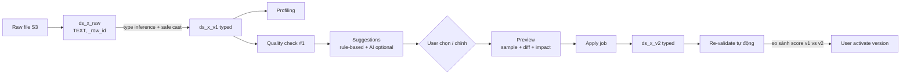

# InsightAI – Data Quality & Cleaning Engine Design

> Trạng thái: **Phase 0 – Proposed**. Lõi kỹ thuật thứ nhất. Quyết định liên quan: D-04, D-10, D-11, D-12.

Nguyên tắc:
1. Mọi check chạy **set-based trong PostgreSQL** trên toàn bộ version, không load dữ liệu vào Node.js.
2. Dữ liệu gốc **bất biến** (raw file trên S3 + bảng raw TEXT). Cleaning luôn tạo version mới.
3. AI chỉ **gợi ý**; chỉ người dùng (hoặc rule đã được phê duyệt) mới apply.
4. Mọi thay đổi có lịch sử, có thể tái lập (operation list có thứ tự, tham số đầy đủ).

---

## 1. Pipeline


Version chỉ trở thành `active` (nguồn cho Semantic Layer) khi user activate – mặc định version mới nhất sau apply được đề xuất activate, không tự động.

---

## 2. Import, schema & type detection

### 2.1 Parsing
- CSV: `csv-parse` streaming; tùy chọn delimiter (auto-detect `, ; \t |`), quote, encoding (UTF-8, UTF-8 BOM, UTF-16, Windows-1258 qua `iconv-lite`), header row.
- XLSX: `exceljs` streaming WorkbookReader; chọn sheet; ngày Excel serial → timestamp; công thức lấy giá trị đã tính (cached value); merged cells → cảnh báo.
- Ghi vào staging qua `COPY … FROM STDIN` (`pg-copy-streams`) theo batch → nhanh, bộ nhớ hằng số.

### 2.2 Chuẩn hóa tên cột
`original_name` giữ nguyên; `name` = slug (bỏ dấu, lowercase, `_`), unique trong dataset; `physical_name` = `c_<ordinal>` (không bao giờ dùng tên từ file làm identifier SQL → loại bỏ cả một lớp injection & giới hạn 63 byte).

### 2.3 Type inference
Ứng viên: `boolean, integer, decimal, date, timestamp, text`. Với mỗi cột, một query duy nhất trên bảng raw đếm số giá trị non-empty khớp từng pattern (regex Postgres) theo locale đã chọn:

| Kiểu | Pattern ví dụ (locale vi) |
|---|---|
| integer | `^[+-]?\d{1,3}(\.\d{3})*$` hoặc `^[+-]?\d+$` |
| decimal | `^[+-]?\d{1,3}(\.\d{3})*(,\d+)?$` (vi) / `^[+-]?\d{1,3}(,\d{3})*(\.\d+)?$` (en) |
| date | `dd/MM/yyyy`, `yyyy-MM-dd`, `d/M/yyyy` |
| timestamp | ISO 8601, `dd/MM/yyyy HH:mm[:ss]` |
| boolean | `true/false/yes/no/có/không/1/0` (chỉ khi distinct ≤ 2) |

Chọn kiểu hẹp nhất có `match_ratio ≥ 0.95` (cấu hình được); lưu `inferred_type`, `type_confidence`, `detected_format`. User có thể override kiểu/format trước khi tạo bảng typed. Ngưỡng < 100% nghĩa là có giá trị không cast được → chúng trở thành `NULL` ở bảng typed và tự động sinh issue **Validity** (so với raw).

Safe cast: các hàm SQL `app_try_cast_numeric(text, locale)`, `app_try_cast_date(text, fmt)` (PL/pgSQL `IMMUTABLE`, bắt exception trả NULL) – tạo bằng migration.

---

## 3. Lưu trữ phục vụ quality

- `ds_x_raw`: TEXT, bất biến, chỉ tồn tại cho import (không cho mỗi version cleaning).
- `ds_x_vN`: typed, mỗi dòng có `_row_id BIGINT` (ổn định xuyên version – cleaning không đổi `_row_id`; dòng bị xóa thì biến mất; dòng tạo mới không có trong MVP) → issue và diff tham chiếu được "cùng một bản ghi" giữa các version và về giá trị gốc.

---

## 4. Rule model

```ts
type QualityRule = {
  id: string; datasetId: string;
  dimension: 'completeness'|'uniqueness'|'validity'|'consistency'|'referential_integrity';
  type: RuleType; params: RuleParams;           // discriminated union, Zod
  columns: string[];                            // tham chiếu dataset_column.name (ổn định qua version)
  severity: 'info'|'warning'|'error';
  weight: number;                               // 1..10, mặc định 1
  threshold?: number;                           // pass nếu pass_rate ≥ threshold (mặc định 1.0)
  enabled: boolean; origin: 'system'|'user'|'ai_suggested';
  status: 'active'|'pending_approval';          // rule do AI gợi ý phải được duyệt
};
```

| Dimension | Rule type | Params | SQL (đơn giản hóa) |
|---|---|---|---|
| Completeness | `not_null` | – | `COUNT(*) FILTER (WHERE c IS NULL OR c::text ~ '^\s*$')` |
| | `completeness_ratio` | `minRatio` | như trên, so tỉ lệ |
| Uniqueness | `unique` | `columns[]` (composite) | `GROUP BY cols HAVING COUNT(*)>1` |
| | `duplicate_rows` | `ignoreColumns[]` | hash toàn dòng `md5(row(...)::text)` |
| Validity | `type_castable` (system) | – | raw non-empty nhưng typed NULL (join `_row_id`) |
| | `regex` | `pattern`, tập preset (email, phone VN, mã số thuế) | `c !~ $1` – pattern validate bằng `safe-regex2` trước khi lưu |
| | `allowed_values` | `values[]`, `caseSensitive` | `c <> ALL($1)` |
| | `range` | `min`, `max`, `inclusive` | numeric/date |
| | `length` | `min`, `max` | |
| Consistency | `expression` | `expr` (Expression DSL) | `NOT (expr)` – vd. `paid_at >= created_at`, `CASE WHEN payment_status='PAID' THEN paid_at IS NOT NULL ELSE true END`, `total_amount = quantity * unit_price` (có `tolerance`) |
| Referential | `foreign_key` | `refDatasetId`, `refColumn` (active version) | `LEFT JOIN ref ON … WHERE ref.k IS NULL AND c IS NOT NULL` |

Rule tham chiếu cột theo `name` → khi version mới đổi schema (vd. drop column), rule tham chiếu cột không còn sẽ `skipped` với lý do rõ, không lỗi cả check.

System rules sinh tự động khi import: `type_castable` cho mọi cột typed khác text; `duplicate_rows`. Rule khác do user tạo hoặc chấp nhận từ gợi ý.

---

## 5. Check execution

Quality worker cho mỗi `quality_check` (gắn `dataset_version_id`):
1. Load rule enabled + active của dataset; compile mỗi rule thành **một** SQL trả `evaluated_count, failed_count` và một SQL lấy **mẫu** dòng lỗi (`LIMIT 500` theo rule, sắp theo `_row_id`).
2. Các rule cùng bảng, cùng dạng đơn giản (not_null, range, allowed_values, regex, expression) được **gộp vào một lần scan**: `SELECT COUNT(*) FILTER (WHERE <fail_1>) AS r1, COUNT(*) FILTER (WHERE <fail_2>) AS r2, … FROM t`. Uniqueness và FK chạy riêng.
3. Chạy bằng role `t_xxx_reader`, `statement_timeout` dài hơn query AI (vd. 120s), mỗi rule lỗi riêng không làm fail cả check (`rule_result.status = error`).
4. Ghi `quality_check_results` (1 dòng/rule) và `quality_issues` (mẫu) trong một transaction; tính score; `quality_checks.status = COMPLETED`.
5. Idempotent: chạy lại cùng `check_id` xóa kết quả cũ của chính check đó trong transaction rồi ghi lại.

### 5.1 Quality score

- Rule pass rate: `p_r = 1 − failed / evaluated` (evaluated = số dòng áp dụng; với `not_null` là tổng dòng; với `foreign_key` là dòng có giá trị non-null).
- Severity multiplier: info 0.5, warning 1, error 2.
- Dimension score: `S_d = Σ(w_r·m_r·p_r) / Σ(w_r·m_r)` trên các rule của dimension.
- Overall: `S = Σ(W_d·S_d) / Σ(W_d)` chỉ trên dimension có rule; `W_d` mặc định bằng nhau, org cấu hình được.
- Hiển thị 0–100, kèm số rule fail theo severity. **Gate**: nếu bất kỳ rule `error` nào fail (dưới threshold) → dataset version gắn nhãn `quality_status = FAILED` bất kể score (score cao không được che lỗi nghiêm trọng).

Công thức đơn giản, giải thích được cho người dùng – có "breakdown" trên UI.

### 5.2 Report
- Tổng quan: score, theo dimension, xu hướng qua các version.
- Theo cột: các rule, failed count, % , mẫu giá trị lỗi phổ biến (`GROUP BY value ORDER BY count DESC LIMIT 10`).
- Theo bản ghi: bảng issue (row_id, column, giá trị typed, giá trị raw, rule, message) có phân trang; "xem dòng đầy đủ".
- Export CSV các dòng lỗi (query lại theo rule, không chỉ mẫu) – chạy job nền, link S3 hết hạn.

---

## 6. Cleaning

### 6.1 Operations (MVP)

| Op | Params | Ghi chú |
|---|---|---|
| `trim_whitespace` | columns | |
| `change_case` | columns, `lower|upper|title` | |
| `replace_values` | column, mapping `{from: to}` | chuẩn hóa danh mục ("HN","Ha Noi" → "Hà Nội") |
| `fill_null` | column, strategy `constant|mean|median|mode|previous`, value | `previous` theo `_row_id` |
| `cast_column` | column, targetType, format/locale | re-parse từ **raw** (giữ nguyên giá trị gốc) |
| `parse_date` | column, formats[] | thử lần lượt |
| `drop_rows` | condition (Expression DSL) hoặc `ruleId` (dòng fail rule) | |
| `deduplicate` | keyColumns, keep `first|last` theo orderBy | |
| `rename_column` | column, newName | |
| `drop_column` | column | |

Mỗi op compile thành SQL expression trên cột (map) hoặc predicate (filter). Toàn bộ danh sách op compile thành **một** `CREATE TABLE ds_x_vN+1 AS SELECT … FROM ds_x_vN WHERE …` (op dạng window như dedupe/fill previous dùng CTE nối tiếp) → một lần ghi, nguyên tử.

### 6.2 Suggestions
- **Rule-based (tất định, luôn có)**: từ quality results và profile — vd. cột text có khoảng trắng đầu/cuối → `trim`; giá trị gần giống nhau (cùng chuỗi sau unaccent+lower, hoặc Levenshtein ≤ 2 trên top-values) → `replace_values`; null rate thấp ở cột numeric → `fill_null median`; dòng trùng hoàn toàn → `deduplicate`; cột cast fail có pattern ngày khác → `parse_date`.
- **AI (tùy chọn, bật theo org)**: LLM chỉ nhận **profile + top values + mẫu giá trị lỗi** (≤ 50 giá trị/cột), trả về danh sách op theo đúng JSON schema của op ở trên + `rationale`. Op được validate như op của user; trạng thái `suggested`, hiển thị nhãn "AI đề xuất".
- Không suggestion nào tự apply. Một "approved cleaning recipe" (danh sách op đã duyệt, lưu theo dataset) có thể được chạy lại cho lần import kế tiếp – đây là "quy tắc đã được phê duyệt" theo yêu cầu, và vẫn cần user bấm chạy trong MVP.

### 6.3 Preview
- Chạy cùng SQL đã compile nhưng: trên mẫu (`TABLESAMPLE SYSTEM` hoặc 1.000 dòng có lỗi + 1.000 dòng ngẫu nhiên), trong transaction READ ONLY, trả về diff theo `_row_id`: cột/giá trị trước → sau.
- Impact tính trên toàn bảng bằng `COUNT(*) FILTER` (không tạo bảng): số dòng bị đổi theo op, số dòng bị xóa, null trước/sau.
- Ước lượng score sau cleaning: không tính trong preview (đắt); có ngay sau apply nhờ re-validate.

### 6.4 Apply
1. `cleaning_job` (PENDING) + snapshot op list (bất biến) → queue.
2. Worker: `CREATE TABLE` version mới (role writer) → `ANALYZE` → ghi `dataset_version` (parent = source, `cleaning_job_id`) + `dataset_columns` + số dòng ảnh hưởng mỗi op (`cleaning_operations.affected_rows`).
3. Enqueue profiling + quality check trên version mới (re-validation) với cùng rule set → UI so sánh v_N vs v_N+1.
4. Audit log: ai apply, op nào, version nào.

Rollback = activate lại version cũ (không xóa gì).

---

## 7. Profiling

Một query aggregate/cột-nhóm trên version: `count, null_count, distinct_count, min, max, mean, stddev, p25/p50/p75` (numeric), `min/max length`, top-10 values + frequency, histogram 20 bucket (`width_bucket`), với date: min/max, phân bố theo tháng. Bảng > 1 triệu dòng: distinct & percentile tính trên `TABLESAMPLE` và đánh dấu `approximate: true`. Lưu JSONB trong `column_profiles` theo `dataset_version_id`.

---

## 8. Kiểm thử trọng tâm
- Unit: compiler rule → SQL (snapshot SQL + params), Expression DSL parser/type-checker, score formula, type inference patterns (bộ test giá trị VN/EN).
- Integration (Postgres thật qua Testcontainers hoặc service container CI): fixture CSV có lỗi đã biết số lượng → khẳng định `failed_count` chính xác cho từng rule; cleaning apply → re-validate cho số lỗi kỳ vọng; idempotency khi chạy lại job.
- Bảo mật: tên cột độc hại trong CSV (`"; DROP TABLE x; --`), regex ReDoS, file XLSX zip-bomb.
