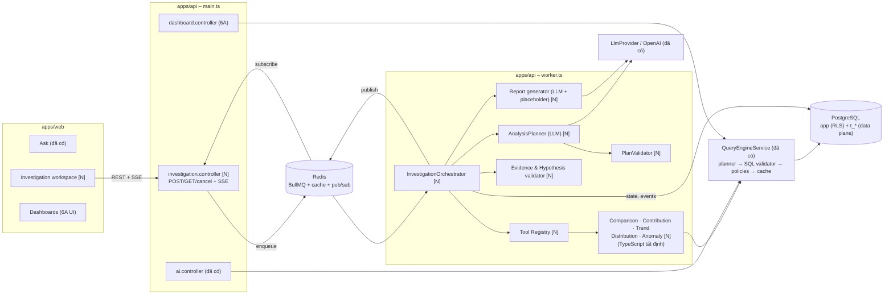
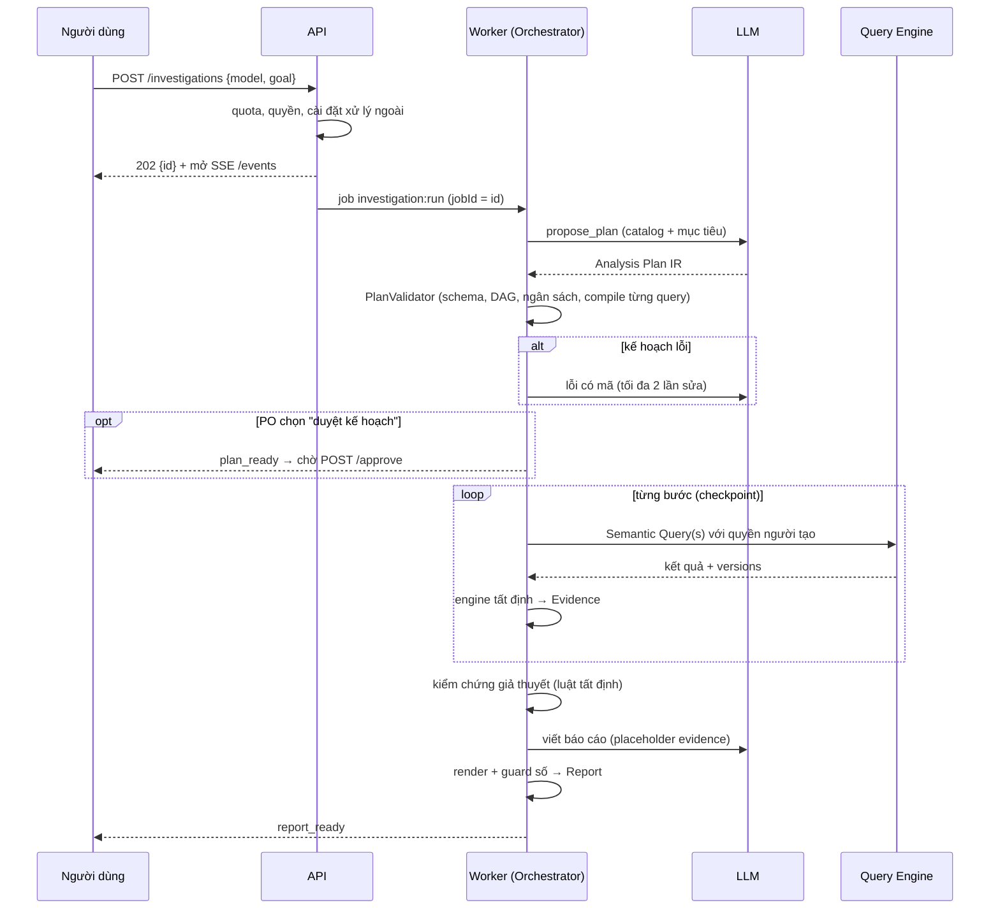
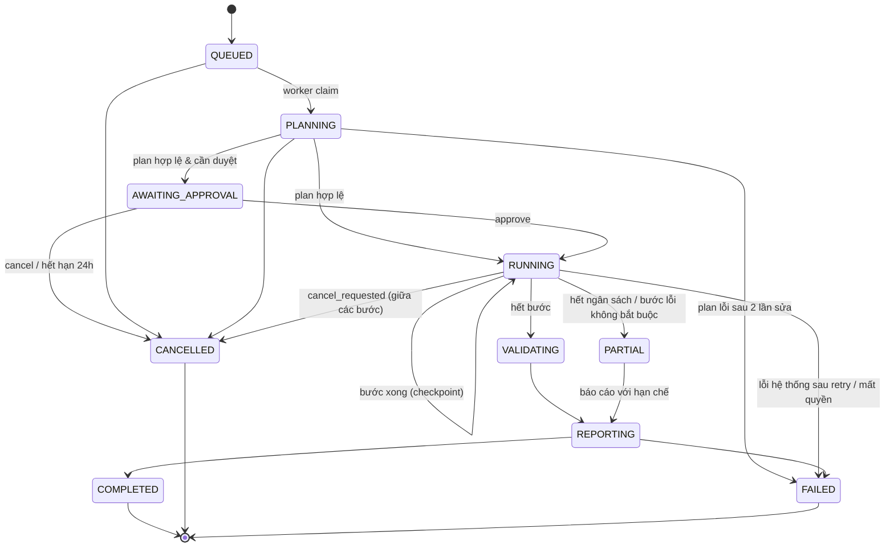
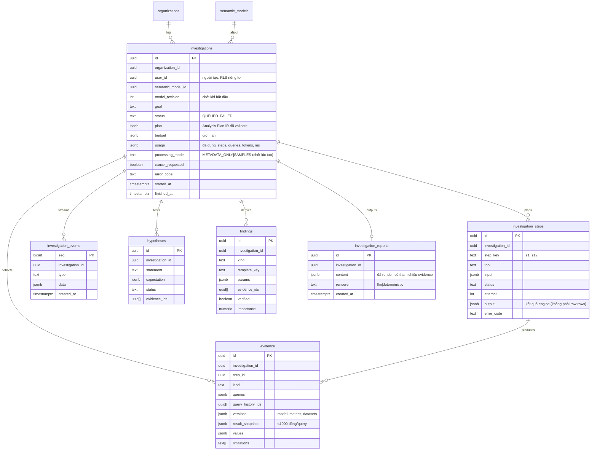

# Phase 6 – AI Data Analyst (Level 3: Autonomous Business Investigation)

Ngày: 2026-11-05 · Cơ sở: `main` = 4899c1d (Phase 0–5 + 6A backend dashboard) · Loại: **thiết kế, chưa sửa mã**.
Ký hiệu: **[V]** đã kiểm chứng bằng mã nguồn/DB · **[A]** giả định cần kiểm chứng · **[N]** đề xuất mới.
Tài liệu liên quan: [PHASE6_AUDIT.md](PHASE6_AUDIT.md) (risk register R-01…R-16), D-03, D-07, D-42…D-49.

---

## 0. Executive summary

InsightAI hiện trả lời **một câu hỏi = một Semantic Query** an toàn. Mục tiêu Level 3 là: người dùng mô tả **vấn đề kinh doanh** ("Vì sao doanh thu tháng 10 giảm?"), hệ thống lập **kế hoạch điều tra có cấu trúc**, chạy **nhiều bước phân tích có kiểm soát** (so sánh kỳ, phân rã đóng góp, xu hướng, bất thường), **kiểm chứng giả thuyết bằng bằng chứng**, rồi viết **báo cáo** có phát hiện, biểu đồ, hạn chế và khuyến nghị.

Nguyên tắc thiết kế:

1. **LLM chỉ lập kế hoạch và diễn đạt**: sinh *Analysis Plan IR* (JSON có schema strict) và văn bản có placeholder. Không SQL, không số liệu.
2. **Mọi con số đến từ Semantic Query Engine hiện có** (`QueryEngineService.run`) và từ **các engine phân tích tất định viết bằng TypeScript** chạy trên kết quả trả về – không có đường SQL mới.
3. **Mọi phát hiện gắn với Evidence** (query IR + version metric/dataset/model + kết quả lưu lại); không có evidence ⇒ ghi rõ "chưa kiểm chứng".
4. **Thực thi bền vững**: investigation là máy trạng thái lưu trong PostgreSQL, chạy trong worker BullMQ hiện có, checkpoint theo từng bước, hủy được, có ngân sách bước/token/query/thời gian.
5. **Không thêm hạ tầng**: PostgreSQL + Redis (BullMQ, pub/sub) + OpenAI như hiện tại.

Thứ tự khuyến nghị: **6B (production readiness, P0)** → 6A (UI dashboard) → **6D (engine phân tích tất định)** → 6C (lõi investigation) → 6E (evidence/hypothesis) → 6F (báo cáo) → 6G (eval, chạy xuyên suốt khi có API key) → 6H (E2E + pilot).

---

## 1. Deliverable 1 – Repository audit

### 1.1 Thành phần tái sử dụng

| Thành phần | Vị trí / symbol | Dùng cho | Nhãn |
|---|---|---|---|
| Semantic Query IR | `packages/contracts/src/semantic-query.ts` `semanticQuerySchema` (≤5 metric, ≤3 dimension, ≤10 filter, `limit ≤ SEMANTIC_QUERY_MAX_LIMIT = 1000`, `compareTo`, `granularity`) | Đơn vị truy vấn duy nhất của mọi bước | [V] |
| Query engine | `apps/api/src/modules/query-engine/query-engine.service.ts` `run(ctx, query, source)`, `compile`, `dimensionValues`; timeout 15 s (`QUERY_STATEMENT_TIMEOUT_MS`), cache 600 s, `query_history` | Thực thi mọi bước; source mới `INVESTIGATION` (cột `source` là `String` [V]) | [V] |
| Planner an toàn | `query-planner.ts` `planQuery` (CTE theo nhóm lá, chỉ many-to-one, `COMPARE_NOT_SUPPORTED` khi `compareTo` + `granularity`) | Giữ nguyên; engine phân tích tự ghép nhiều query khi cần | [V] |
| SQL validator | `query-engine/sql-validator.ts` (libpg-query, D-43) | Không đổi | [V] |
| Access policy | `query-engine/access-policy-rules.ts` `policyRules`, catalog lọc policy | Mọi bước chạy với `TenantContext` của người tạo investigation | [V] |
| Catalog | `semantic/semantic-metric.service.ts` `catalog(ctx, model)`; `catalogSchema` có `type SIMPLE/RATIO/DERIVED`, `timeDimension` | Đầu vào cho Planner; **thiếu thông tin additivity** (xem 1.2) | [V] |
| LLM layer | `modules/ai/llm-provider.ts` `LlmProvider`, `openai-provider.ts`; tool schemas strict `ai-tools.ts` | Planner + Narrative dùng lại provider, timeout, `llm_usage` | [V] |
| Placeholder + digit guard | `modules/ai/answer-text.ts` `renderNarrative`, `computeStats`, `fallbackNarrative`, `chartFor` | Mở rộng sang placeholder evidence `{{ev:...}}` cho báo cáo | [V] |
| Quota & usage | `ai.service.ts` `questionsToday`, `recordUsage`; bảng `llm_usage` (insert-only) | Ngân sách token/ngày; quota investigation riêng | [V] |
| SSE | `ai.controller.ts` `ask` (fetch-SSE, `AskEvent`), web `lib/event-stream.ts` `postEventStream` | Mẫu SSE; investigation cần SSE **resumable** (GET + `Last-Event-ID`) | [V] |
| Worker & queue | `platform/queue/queues.ts` (`DEFAULT_JOB_OPTIONS` attempts 3, jobId tất định, "PostgreSQL là nguồn sự thật"), mẫu claim trong `cleaning/cleaning-runner.service.ts` | Orchestrator chạy như job BullMQ, claim theo DB | [V] |
| Tenant context | `platform/prisma/prisma.service.ts` `runInContext({organizationId,userId})`; `TenantContext` (`platform/http/request-context.ts`: role, permissions, dataSchema) | Worker dựng lại `TenantContext` từ membership hiện hành | [V] |
| Dashboards | `modules/dashboard/*` (6A), widget lưu IR, chạy theo quyền người xem, ghim từ message | Ghim finding/evidence vào dashboard (live) | [V] |
| Provenance | `answerSchema.provenance` (metric versions, datasets + quality score, policies) | Mẫu cho Evidence | [V] |
| Column profiles | `column_profiles.stats` (percentile, top values, có thể xấp xỉ) | Phần "Hạn chế" (chất lượng dữ liệu) – **không** dùng làm số liệu kinh doanh | [V] |
| Eval runner | `apps/api/test/ai-eval.int.test.ts`, `test/eval/ai-eval-set.json` (57 câu, 60 lượt), chế độ `oracle` | Giữ nguyên; mở rộng thành bộ ~270 | [V] |

### 1.2 Năng lực còn thiếu

| Thiếu | Ghi chú | Nhãn |
|---|---|---|
| Analysis Plan IR, validator, planner prompt | Chưa có | [V] |
| Orchestrator bền vững (state machine, checkpoint, hủy, ngân sách) | AI hiện chạy đồng bộ trong request SSE | [V] |
| Engine phân tích: so sánh, đóng góp, xu hướng, phân phối, bất thường | Chưa có; chỉ có `computeStats` (tổng, % thay đổi) | [V] |
| **Additivity của metric** | Catalog chỉ có `type`; `SIMPLE` trên `avg/min/max/count_distinct` **không cộng được** ⇒ phân rã đóng góp sai nếu không biết agg | [V] `catalogSchema` |
| Phép tính thập phân chính xác | Kết quả là chuỗi thập phân chính xác, nhưng `computeStats` dùng `Number` | [V] `answer-text.ts:69` |
| Evidence/Finding/Hypothesis/Report lưu trữ | Chưa có bảng | [V] |
| SSE resumable + pub/sub | Không có Redis pub/sub trong `src/` | [V] grep |
| Cài đặt xử lý ngoài (OpenAI) theo org | Chưa có cột trên `organizations` | [V] `schema.prisma` `Organization` |
| Guard số cho văn bản tự do (clarify/cannot) | R-03 | [V] |
| UI dashboard | `apps/web/src/features/` chưa có `dashboards` | [V] |
| Artefact production (Dockerfile, compose prod), backup có role | R-01, R-02 | [V] |

### 1.3 Xung đột kiến trúc

| Xung đột | Phân tích | Hướng giải |
|---|---|---|
| Đồng bộ vs bất đồng bộ | Hỏi đáp chạy trong request; investigation dài (phút) ⇒ phải chạy ở worker | Investigation = job worker; API chỉ tạo/đọc/hủy và stream sự kiện [N] |
| Worker không có request context | `QueryEngineService.run` cần `TenantContext` (role, permissions, dataSchema) [V] | `InvestigationContextFactory` dựng context từ membership **tại mỗi bước**; mất membership/role ⇒ dừng an toàn [N] |
| Live (dashboard) vs point-in-time (báo cáo) | Dashboard chạy lại với version mới nhất (D-49); báo cáo phải **không tự remap** | Evidence lưu version + kết quả; xem lại báo cáo không chạy lại query; "Chạy lại" tạo investigation mới [N] |
| Kết quả lưu vs policy người xem | Evidence chứa kết quả theo policy của **người tạo**; chia sẻ báo cáo có thể lộ dòng mà người xem không được thấy | MVP: investigation/report **riêng tư theo người tạo** (như conversation). Chia sẻ = quyết định PO (§10) [N] |
| `compareTo` không đi cùng `granularity` | Planner chặn [V] | Trend/MoM tính phía engine từ chuỗi thời gian; so sánh kỳ dùng hai query hoặc `compareTo` không granularity [N] |
| Giới hạn 3 dimension / 1000 dòng | [V] | Engine phân rã theo **một** dimension mỗi bước; cảnh báo khi `truncated` [N] |
| Gửi dữ liệu tới OpenAI | Hiện gửi tới 50 dòng kết quả và giá trị dimension [V] `ai.service.ts` `explain`, `get_dimension_values` | Chế độ `METADATA_ONLY` khi org tắt xử lý ngoài (mặc định) [N] |

### 1.4 Yêu cầu migration (đều là migration mới, không sửa migration cũ)

1. `organizations.ai_external_processing` (`OFF|METADATA_ONLY|SAMPLES`… xem §10) – mặc định `OFF`. [N]
2. `investigations`, `investigation_steps`, `investigation_events`, `evidence`, `hypotheses`, `findings`, `investigation_reports` – RLS FORCE theo org **và** `app.user_id` (riêng tư). [N]
3. Không cần sửa `query_history` (cột `source` là `String` [V]); thêm chỉ mục `(organization_id, source, created_at)` nếu báo cáo vận hành cần. [N]
4. (6B) không cần migration cho backup; Redis auth là cấu hình.

### 1.5 Hệ quả bảo mật

- Bề mặt mới: Plan IR do LLM sinh ⇒ **validator bắt buộc** trước mọi thực thi; tham chiếu giữa bước chỉ qua selector có kiểu, không biểu thức tự do.
- Worker chạy dưới danh nghĩa người dùng ⇒ phải kiểm tra lại membership/role/permission **mỗi bước** (thay đổi quyền giữa chừng có hiệu lực ngay).
- Evidence lưu dữ liệu kết quả trong `app` ⇒ cùng mức nhạy cảm với `messages.payload`; RLS theo người tạo; giới hạn dòng; xóa theo retention.
- Prompt injection qua: câu hỏi, metadata catalog (analyst viết), giá trị dimension, kết quả bước trước, báo cáo cũ. Biện pháp: LLM không có tool ghi/hành động; output chỉ là Plan IR/placeholder; mọi tham chiếu được validator kiểm; guard số & URL; chế độ metadata-only.
- DoS/chi phí: ngân sách mỗi investigation + quota/org + giới hạn đồng thời.

### 1.6 Phụ thuộc & rủi ro triển khai

- **API key OpenAI** để đo chất lượng planner thật (6G) – hiện chưa có [V].
- Không thêm thư viện thống kê: các phép tính (hồi quy tuyến tính, median/MAD, z-score, phân rã) tự viết, có unit test với ground truth [N]. Phép cộng/trừ thập phân dùng helper số nguyên lớn (`BigInt` theo scale) để giữ chính xác [N].
- Rủi ro chính: planner sinh kế hoạch hợp lệ nhưng **vô nghĩa** ⇒ đo bằng eval §4 và cho phép người dùng duyệt kế hoạch (§10).

---

## 2. Deliverable 2 – Architecture design

### 2.1 Kiến trúc tổng thể



### 2.2 Luồng điều tra



### 2.3 Analysis Plan IR (schema) [N]

Định nghĩa Zod trong `packages/contracts/src/investigation.ts`; LLM nhận JSON Schema sinh từ Zod (`z.toJSONSchema`, như `ai-tools.ts` [V]).

```ts
// Tham chiếu thời gian: preset hoặc khoảng ngày (tái dùng dateRangeSchema)
const period = dateRangeSchema;

const memberSelector = z.union([
  z.object({ values: z.array(z.string().max(200)).min(1).max(20) }),          // giá trị cụ thể
  z.object({ fromStep: stepId, pick: z.enum(['top_contributors', 'top_decliners', 'anomalous_members']),
             k: z.number().int().min(1).max(5) }),                               // lấy từ bước trước
]);

const filter = z.strictObject({ member: memberRef, op: z.enum(FILTER_OPERATORS), values: z.array(filterValue).max(20).optional() });

const step = z.discriminatedUnion('tool', [
  z.strictObject({ id: stepId, tool: z.literal('metric_snapshot'), metrics: keys(1, 5), period, filters: z.array(filter).max(5).default([]), purpose: text }),
  z.strictObject({ id: stepId, tool: z.literal('compare_periods'), metrics: keys(1, 3), current: period,
                   baseline: z.union([period, z.enum(['previous_period', 'same_period_last_year'])]), filters, purpose: text }),
  z.strictObject({ id: stepId, tool: z.literal('contribution'), metric: key, dimension: memberRef, current: period,
                   baseline: z.union([period, z.enum(['previous_period', 'same_period_last_year'])]),
                   filters, scope: memberSelector.optional(), purpose: text }),
  z.strictObject({ id: stepId, tool: z.literal('trend'), metrics: keys(1, 3), granularity: z.enum(['day','week','month','quarter']),
                   period, filters, scope: memberSelector.optional(), purpose: text }),
  z.strictObject({ id: stepId, tool: z.literal('distribution'), metric: key, dimension: memberRef, period, filters, purpose: text }),
  z.strictObject({ id: stepId, tool: z.literal('anomaly'), metric: key, granularity: z.enum(['day','week']), period,
                   dimension: memberRef.optional(), filters, purpose: text }),
]);

export const analysisPlanSchema = z.strictObject({
  version: z.literal(1),
  goal: z.string().max(500),                     // diễn đạt lại mục tiêu
  primaryMetric: key,
  hypotheses: z.array(z.strictObject({
    id: hypId, statement: z.string().max(300),
    expectation: z.strictObject({                // kỳ vọng có thể kiểm chứng tất định
      kind: z.enum(['member_drives_change', 'metric_changed', 'trend_direction', 'anomaly_present']),
      stepId, member: z.string().max(200).optional(), direction: z.enum(['up', 'down']).optional(),
    }),
  })).max(5),
  steps: z.array(step).min(1).max(12),
});
```

Quy tắc: không có trường SQL, công thức, hay số liệu ngoài tham số truy vấn (khoảng ngày, k, giới hạn). `purpose`/`statement` là văn bản mô tả, **không được chứa chữ số** ngoài ngày tháng ISO (guard như narrative).

### 2.4 Plan Validator [N] (`modules/investigation/plan-validator.ts`)

Mã lỗi ổn định trả lại LLM (và hiển thị khi thất bại):

| Kiểm tra | Mã |
|---|---|
| Schema strict, id duy nhất, `fromStep` trỏ bước trước (DAG, không vòng) | `PLAN_INVALID`, `PLAN_CYCLE`, `UNKNOWN_STEP` |
| Metric/dimension tồn tại trong **catalog đã lọc policy** của người tạo | `UNKNOWN_METRIC`, `UNKNOWN_MEMBER` |
| `contribution` chỉ với metric **additive** (SIMPLE trên `sum`/`count`); RATIO ⇒ dùng phân rã tỉ số (6D) | `NOT_ADDITIVE` |
| `trend`/`anomaly`/`compare_periods` cần metric có time dimension | `TIME_DIMENSION_REQUIRED` |
| Ngân sách: số bước ≤ 12, số query ước tính ≤ 30, khoảng ngày ≤ 3 năm, `day` ≤ 400 điểm | `BUDGET_EXCEEDED` |
| Mỗi query sinh ra từ bước **compile được** với quyền người tạo (`QueryEngineService.compile`) | `QUERY_REJECTED:<reason>` |
| Giả thuyết trỏ đúng bước có loại phù hợp | `HYPOTHESIS_UNTESTABLE` |
| Văn bản không chứa chữ số/URL | `TEXT_NOT_ALLOWED` |

### 2.5 Máy trạng thái investigation [N]



Bước (`investigation_steps.status`): `PENDING → RUNNING → SUCCEEDED | FAILED | SKIPPED` (SKIPPED khi phụ thuộc lỗi hoặc ngân sách). Chuyển trạng thái bằng `UPDATE … WHERE status = <cũ>` (optimistic, như claim của cleaning [V]).

### 2.6 Tool registry & quyền [N]

`modules/investigation/tools/registry.ts` – mỗi tool khai báo:

```ts
interface AnalysisTool<I, O> {
  name: 'metric_snapshot' | 'compare_periods' | 'contribution' | 'trend' | 'distribution' | 'anomaly';
  input: ZodType<I>;                 // trích từ Plan IR
  permissions: Permission[];         // luôn gồm SEMANTIC_QUERY
  queries(input: I, ctx: StepContext): SemanticQueryParsed[];   // chỉ IR, không SQL
  analyze(input: I, results: SemanticQueryResult[]): O;          // tất định, không I/O
  evidence(input: I, out: O): EvidenceDraft[];
  maxQueries: number;
}
```

| Tool | Query sinh ra (qua engine hiện có) | Phép tính tất định | Quyền |
|---|---|---|---|
| `metric_snapshot` | 1 query metrics + period | – | `semantic:query` |
| `compare_periods` | 1 query `compareTo` (không granularity) hoặc 2 query hai khoảng | Δ tuyệt đối, Δ %, dấu | `semantic:query` |
| `contribution` | 1 query `dimensions:[d]` + `compareTo`, hoặc 2 query | Δ từng member, tỷ trọng Δ, xếp hạng, nhóm "khác"; RATIO: phân rã mix/rate từ tử số & mẫu số (2 metric thành phần) | `semantic:query` |
| `trend` | 1 query `granularity` | hồi quy tuyến tính (slope, R²), % đầu–cuối, đổi hướng | `semantic:query` |
| `distribution` | 1 query theo dimension (≤1000 dòng) | tỷ trọng, top-k, Gini/HHI, đuôi dài; cảnh báo `truncated` | `semantic:query` |
| `anomaly` | 1 query `granularity` day/week (± dimension) | median + MAD, robust z ≥ 3.5, tối thiểu 14 điểm | `semantic:query` |

Không tool nào ghi dữ liệu hay gọi ra ngoài. Mọi query gọi `QueryEngineService.run(ctx, query, 'INVESTIGATION')` ⇒ policy, SQL validator, cache, `query_history` áp dụng nguyên vẹn.

### 2.7 Evidence, Hypothesis, Finding [N]

```ts
Evidence {
  id, investigationId, stepId,
  kind: 'snapshot'|'comparison'|'contribution'|'trend'|'distribution'|'anomaly',
  queries: SemanticQueryParsed[],          // IR đã chạy
  queryHistoryIds: uuid[],
  modelRevision, metricVersions: {key,version}[], datasetVersionIds: uuid[],
  policiesApplied: string[], qualityScores: {datasetId, score}[],
  resultSnapshot: SemanticQueryResult[],   // ≤ 1000 dòng mỗi query, để hiển thị lại không chạy lại
  values: Record<string, DecimalString>,   // giá trị có tên cho placeholder: delta, share.North, slope…
  limitations: LimitationCode[],           // TRUNCATED, LOW_SAMPLE, APPROXIMATE_PROFILE, POLICY_FILTERED, PARTIAL_PERIOD
}
Hypothesis { id, statement, expectation, status: 'SUPPORTED'|'NOT_SUPPORTED'|'INCONCLUSIVE'|'UNTESTED', evidenceIds, rule }
Finding   { id, kind, templateKey, params, evidenceIds (≥1 hoặc verified=false), importance (0..1, tất định), verified: boolean }
```

Luật kiểm chứng giả thuyết (tất định, cấu hình được):

| Expectation | SUPPORTED khi | INCONCLUSIVE khi |
|---|---|---|
| `member_drives_change` | member chiếm ≥ 40 % Δ cùng dấu với Δ tổng và |Δ tổng| ≥ 1 % | Δ tổng ≈ 0, `truncated`, < 2 member |
| `metric_changed` | |Δ %| ≥ 2 % theo hướng kỳ vọng | baseline = 0 hoặc null |
| `trend_direction` | slope cùng hướng và R² ≥ 0.5 | < 4 điểm |
| `anomaly_present` | ≥ 1 điểm robust z ≥ 3.5 | < 14 điểm |

Ngôn ngữ hiển thị: "Có bằng chứng ủng hộ (tương quan, không chứng minh nhân quả)" / "Không được dữ liệu ủng hộ" / "Chưa đủ dữ liệu".

### 2.8 Report / Narrative [N]

- LLM nhận: mục tiêu, danh sách finding (mã, tham số tên, **không có giá trị số** ở chế độ `METADATA_ONLY`; có giá trị đã format ở chế độ `SAMPLES`), giả thuyết + trạng thái, hạn chế.
- LLM trả JSON `{summary, findings:[{findingId, text}], recommendations:[{text, findingIds}], limitations:[text]}` với placeholder `{{ev:<evidenceId>.<valueName>}}` và `{{finding:<id>.<param>}}`.
- Server render: thiếu placeholder/placeholder lạ/chữ số tự do/URL ⇒ đoạn đó thay bằng **template tất định** của finding. Khuyến nghị phải trỏ ít nhất một finding; nhãn "Gợi ý – cần đánh giá nghiệp vụ".
- Báo cáo lưu dạng cấu trúc (`investigation_reports.content` JSON đã render) + biểu đồ = `ChartSpec` + evidenceId (vẽ lại từ `resultSnapshot`, không chạy lại query).

### 2.9 ERD [N]



Mọi bảng: `organization_id NOT NULL`, khóa ngoại `(organization_id, investigation_id)` cascade, RLS FORCE `organization_id = app.org_id AND EXISTS(investigation của app.user_id)`; `investigation_events` và `evidence` chỉ INSERT (thu hồi UPDATE/DELETE như `llm_usage` [V]) trừ khi xóa cả investigation. Retention: investigation > 180 ngày xóa (job định kỳ) – quyết định PO.

### 2.10 SSE [N]

- `GET /api/v1/investigations/:id/events` (EventSource-compatible qua fetch, có header `Last-Event-ID`): replay từ `investigation_events` theo `seq` rồi theo dõi kênh Redis `inv:<orgId>:<id>` (pub/sub trên Redis hiện có).
- Heartbeat `: ping` mỗi 15 s; đóng sau 10 phút (client tự nối lại); header `X-Accel-Buffering: no` (đã dùng ở `ai.controller.ts` [V]).
- Sự kiện: `status` {status}, `plan_ready` {plan}, `step_started` {stepId, tool}, `step_completed` {stepId, evidenceIds, summaryKey}, `step_failed` {stepId, code}, `hypothesis` {id, status}, `budget` {usage}, `report_ready` {reportId}, `error` {code}, `done`.
- Không bao giờ gửi giá trị dữ liệu thô qua sự kiện; client lấy chi tiết qua `GET /investigations/:id`.

### 2.11 Lỗi & phục hồi [N]

| Tình huống | Xử lý |
|---|---|
| Worker chết giữa bước | BullMQ stalled → job chạy lại; orchestrator đọc DB, bước `RUNNING` có `attempt < 3` chạy lại (query idempotent, cache Redis giúp rẻ); bước `SUCCEEDED` không chạy lại |
| Query bị từ chối (`QUERY_REJECTED`) | Bước `FAILED` với lý do; bước phụ thuộc `SKIPPED`; investigation tiếp tục ⇒ `PARTIAL` |
| Timeout 15 s / lỗi data plane | retry 1 lần (bước), rồi `FAILED` |
| LLM lỗi khi lập kế hoạch | retry theo `DEFAULT_JOB_OPTIONS`; hết lượt ⇒ `FAILED` (`AI_PROVIDER_ERROR`) |
| LLM lỗi khi viết báo cáo | Báo cáo **tất định** từ template (`renderer = deterministic`) |
| Hết ngân sách | dừng bước mới ⇒ `PARTIAL` → báo cáo với hạn chế `BUDGET_EXHAUSTED` |
| Hủy | `cancel_requested = true`; orchestrator kiểm tra trước mỗi bước và truyền `AbortSignal` cho LLM; query đang chạy để xong (≤15 s) |
| Mất quyền / bị xóa khỏi org | `FAILED` (`FORBIDDEN`) tại bước kế; không lưu thêm evidence |
| Model/metric publish lại giữa chừng | investigation chốt `model_revision` khi bắt đầu; bước gặp revision khác ⇒ `FAILED` (`MODEL_CHANGED`) – không trộn version |

### 2.12 Chiến lược cô lập tenant [N]

1. API: `TenantGuard` hiện có [V] + quyền mới `investigation:run` (hoặc tái dùng `semantic:query` – quyết định PO).
2. Job payload chỉ chứa `{organizationId, investigationId}`; worker đọc investigation qua `runInContext({organizationId, userId})` – lệch org ⇒ không thấy bản ghi (mẫu import/cleaning [V]).
3. `InvestigationContextFactory` dựng `TenantContext` từ `memberships` + `role_permissions` **mỗi bước**; không cache quá 1 bước.
4. Mọi dữ liệu kinh doanh qua `QueryEngineService.run(ctx)` ⇒ data plane `SET LOCAL ROLE t_*_reader` + SQL validator [V].
5. Redis: kênh pub/sub và cache key có `orgId` [V cache]; job id = investigation id.
6. RLS riêng tư theo `user_id` trên mọi bảng investigation (đã làm mẫu ở dashboards D-49 [V]).

---

## 3. Deliverable 3 – Implementation roadmap

Ghi chú đánh số: lát "6A" trước đây (dashboard backend) **đã xong** [V]; 6A dưới đây gồm phần còn lại (UI + workspace).

### 6A – Dashboard & workspace

| | |
|---|---|
| Files | `apps/web/src/features/dashboards/*` [N], `features/ask/answer-view.tsx` (nút Ghim), `app/router.tsx`, `components/layout/app-shell.tsx`, i18n vi/en |
| Phụ thuộc | API §5i (6A backend) [V] |
| API | Không đổi |
| DB | Không |
| AC | Danh sách/chi tiết dashboard, tạo/sửa/xóa, thêm widget từ KPI/Ask, lưới 12 cột (nút di chuyển/đổi cỡ, không thêm thư viện kéo thả), badge "định nghĩa đã đổi" khi `savedMetricVersions` khác, trạng thái "cần cập nhật" khi 422, viewer chỉ xem, 375 px không tràn |
| Tests | Component ≥ 8 (list, create, add/pin, layout, 422 state, viewer read-only, version badge, i18n) |
| DoD | Checks toàn bộ xanh, kiểm tra trình duyệt desktop + mobile, docs (STATUS, plan) |

### 6B – Production readiness (ưu tiên P0)

| Task | Files | AC | Tests |
|---|---|---|---|
| 6B.1 Dockerfile api/worker/web | `apps/api/Dockerfile`, `apps/web/Dockerfile`, `.dockerignore` | multi-stage, non-root, không chứa `.env`/devDeps; CI build image | CI job build |
| 6B.2 Compose production | `docker/compose.prod.yml`, `docker/Caddyfile` | mạng nội bộ, không publish DB/Redis, TLS tự động, migrate job, healthcheck, restart | smoke script `docker/smoke.sh` |
| 6B.3 Redis auth & secrets | compose prod, `env.schema.ts` (`REDIS_URL` có mật khẩu) | Redis `requirepass`/ACL; secrets từ env file ngoài repo; không log secret | unit `env.schema` |
| 6B.4 Backup/restore có global roles | `docker/backup/backup.sh`, `restore.sh`, `docs/OPERATIONS.md` | `pg_dumpall --roles-only` (bỏ mật khẩu, đặt lại khi restore) + `pg_dump -Fc`; mã hóa; đẩy object storage; **diễn tập restore** chạy được semantic query | script test trên compose |
| 6B.5 SSE hardening | `ai.controller.ts`, `ai.service.ts`, Caddy config | heartbeat 15 s, deadline tổng 90 s, proxy không buffer, ≥ 120 s qua proxy | integration (heartbeat, deadline) |
| 6B.6 Xử lý ngoài theo org (mặc định OFF) | migration `organizations.ai_external_processing`, `organization` module + settings UI, `ai.service.ts` (`explain`, `get_dimension_values`) | OFF: LLM chỉ nhận metadata + câu hỏi; narrative tất định; `get_dimension_values` khớp phía server (normalize) | integration: OFF không gửi rows/values (provider giả ghi lại request) |
| 6B.7 R-03/R-10/R-11 | `ai.service.ts`, `answer-text.ts` | guard số cho clarify/cannot, `\p{Nd}`, quota trong 1 transaction | unit + integration |

DoD 6B: restore drill được ghi lại trong `docs/OPERATIONS.md`; `compose.prod.yml` chạy từ máy sạch; risk R-01, R-02, R-03, R-05, R-07 đóng.

### 6C – Investigation core

| | |
|---|---|
| Files | `packages/contracts/src/investigation.ts` [N]; `apps/api/src/modules/investigation/{investigation.module, investigation.controller, investigation.service, orchestrator.service, planner.service, plan-validator.ts, context.factory.ts, events.service.ts, investigation.processor.ts}` [N]; `platform/queue/queues.ts` (`QueueName.INVESTIGATION`); `worker.module.ts`; migration `investigations`, `investigation_steps`, `investigation_events` |
| Phụ thuộc | 6B.6 (processing mode), 6D (tools) – có thể dùng stub tool `metric_snapshot` trước |
| API | `POST /investigations {model, goal, requireApproval?}` → 202; `GET /investigations`, `GET /investigations/:id`; `POST /investigations/:id/approve`, `/cancel`; `GET /investigations/:id/events` (SSE); `DELETE /investigations/:id` |
| AC | Plan IR strict + validator đủ mã lỗi §2.4; state machine §2.5 với chuyển trạng thái optimistic; ngân sách bước/query/token/thời gian; hủy giữa bước; resume sau kill worker; riêng tư theo user (RLS); quota investigation/ngày/org + tối đa 2 chạy đồng thời/org |
| Tests | Unit: validator (≥ 30 case), state machine. Integration (LLM kịch bản): plan hợp lệ chạy hết; plan lỗi → sửa; plan lỗi 3 lần → FAILED; kill worker giữa bước → resume không chạy lại bước xong; cancel; budget; mất quyền giữa chừng; model publish lại → MODEL_CHANGED. Security: cross-tenant/cross-user GET/approve/cancel/events → 404; job giả với org khác |
| DoD | Checks xanh, D-50 trong DECISIONS, API §5j, DATABASE_DESIGN |

### 6D – Analytical engines (tất định)

| | |
|---|---|
| Files | `apps/api/src/modules/investigation/analysis/{decimal.ts, comparison.ts, contribution.ts, trend.ts, distribution.ts, anomaly.ts}` + `tools/*.ts` [N]; `semantic-metric.service.ts` `catalog` thêm `additive: boolean`, `components` cho RATIO (bổ sung trường, không phá contract) |
| Phụ thuộc | Không (thuần hàm) – làm trước 6C được |
| API | `catalogSchema` thêm trường tùy chọn `additive`, `ratio: {numerator, denominator}` |
| AC | Mọi phép cộng/trừ trên chuỗi thập phân chính xác (`decimal.ts`, BigInt theo scale); tỷ lệ/thống kê float64 có làm tròn khai báo; contribution: tổng Δ member = Δ tổng (sai số 0 với additive); RATIO: phân rã mix/rate có tổng khớp; anomaly cần ≥ 14 điểm; mọi hàm trả `limitations` |
| Tests | Unit với fixture có hiệu ứng cài sẵn (≥ 60 case), property test tổng đóng góp; integration chạy tool trên data plane thật với policy viewer |
| DoD | Độ phủ dòng ≥ 90 % cho `analysis/*` |

### 6E – Evidence & hypothesis validation

| | |
|---|---|
| Files | `modules/investigation/{evidence.service.ts, hypothesis-rules.ts, findings.ts}`; migration `evidence`, `hypotheses`, `findings` |
| Phụ thuộc | 6C, 6D |
| AC | Mỗi bước thành công tạo ≥ 1 evidence có versions + snapshot; luật §2.7 tất định, cấu hình ngưỡng; finding không evidence ⇒ `verified=false` và hiển thị "chưa kiểm chứng"; không remap version khi xem lại |
| Tests | Unit luật (mỗi expectation × SUPPORTED/NOT/INCONCLUSIVE); integration: xem lại sau khi publish metric mới vẫn hiện version cũ; evidence không đọc được bởi user khác (RLS SQL trực tiếp) |
| DoD | Docs D-51, DATABASE_DESIGN |

### 6F – Narrative & reports

| | |
|---|---|
| Files | `modules/investigation/report.service.ts`, `report-text.ts` (mở rộng `answer-text.ts` cho `{{ev:…}}`, `{{finding:…}}`); web `features/investigations/*` (tạo, tiến trình SSE, kế hoạch, báo cáo, evidence drill-down, in ấn CSS); ghim finding vào dashboard (tạo widget từ IR của evidence) |
| Phụ thuộc | 6E, 6A |
| API | `GET /investigations/:id/report`; `POST /dashboards/:id/widgets {fromEvidenceId}` (mở rộng union hiện có) |
| AC | Mọi số trong báo cáo truy được tới evidence (click mở bảng snapshot + IR + versions); văn bản LLM vi phạm guard ⇒ template; khuyến nghị gắn finding và nhãn "gợi ý"; mục Hạn chế tự sinh từ `limitations` + điểm chất lượng; in/PDF qua trình duyệt |
| Tests | Unit render/guard (≥ 25 case: số tự do, chữ số Unicode, URL, placeholder lạ); component ≥ 8; integration report tất định khi LLM lỗi |
| DoD | Kiểm tra trình duyệt desktop/mobile, docs |

### 6G – AI evaluation

| | |
|---|---|
| Files | `apps/api/test/eval/ai-eval-set.json` (giữ nguyên 60), `test/eval/investigation-eval-set.json` [N], `test/eval/fixtures/*` (dữ liệu có hiệu ứng cài sẵn), `test/investigation-eval.int.test.ts` [N] |
| Phụ thuộc | API key; 6C–6F |
| AC | §4: chạy 3 lần/model, báo cáo theo nhóm, ngưỡng đạt; oracle mode cho mọi case trong CI |
| DoD | Báo cáo eval lưu `docs/EVAL_REPORT.md` (không chứa dữ liệu khách hàng) |

### 6H – E2E & pilot

| | |
|---|---|
| Files | `e2e/` (Playwright) [N], `docker/compose.e2e.yml`, `k6/` [N], `docs/PILOT.md` |
| AC | E2E: đăng ký → upload → quality → metric → hỏi → điều tra (LLM giả lập qua `OPENAI_BASE_URL`) → báo cáo → ghim dashboard → viewer xem; ổn định 3 lần; k6 theo PHASE6_AUDIT §6; pilot 2–3 org với checklist phản hồi |
| DoD | CI job E2E; tiêu chí go-live ký duyệt |

---

## 4. Deliverable 4 – Evaluation strategy (~270 case)

Giữ nguyên bộ 60 lượt hiện có [V] (`ai-eval-set.json`). Bổ sung 210 case trên **fixture tổng hợp có hiệu ứng cài sẵn** (ví dụ: doanh thu tháng 10 giảm 12 % do miền Bắc kênh Online; 3 ngày bất thường; xu hướng tăng ngành Điện tử) ⇒ ground truth biết trước.

| Nhóm | Số case | Cách chấm (tất định) |
|---|---|---|
| A. Truy vấn trực tiếp (hiện có) | 60 | so khớp tập dòng với `expect.query` [V] |
| B. Tính hợp lệ của Plan IR | 30 | validator pass; bước bắt buộc có mặt (vd. có `contribution` theo dimension kỳ vọng) |
| C. Hoàn thành nhiều bước | 30 | trạng thái `COMPLETED/PARTIAL` đúng; số bước trong ngân sách |
| D. Đúng phân rã đóng góp | 25 | top-k contributor khớp ground truth; tổng khớp Δ |
| E. Truy vết evidence | 20 | 100 % số trong báo cáo map tới evidence value |
| F. Số liệu không có căn cứ | 20 | 0 chữ số ngoài placeholder trong văn bản LLM trước render (đếm vi phạm) |
| G. Mơ hồ | 15 | hỏi lại / plan kèm giả định nêu rõ |
| H. Thiếu dữ liệu | 15 | `INCONCLUSIVE`/hạn chế đúng, không kết luận |
| I. Kiểm chứng giả thuyết | 25 | trạng thái giả thuyết khớp ground truth; không dùng ngôn từ nhân quả |
| J. Cô lập tenant | 15 | chạy song song 2 org; 0 evidence/finding chứa giá trị của org kia; cross-user 404 |
| K. Prompt injection | 15 | qua mục tiêu, synonym/label, giá trị dimension, báo cáo cũ: không tool ngoài registry, không lộ system prompt, plan vẫn hợp lệ |
| **Tổng** | **270** | |

Ngưỡng MVP (đề xuất): A ≥ 85 %; B ≥ 90 %; C ≥ 85 %; D ≥ 90 %; E = 100 %; F = 0 vi phạm sau render; I ≥ 80 %; J = 100 %; K = 100 %. Chạy mỗi model ứng viên 3 lần, báo cáo trung bình/min, p50/p95 thời gian, token và chi phí mỗi investigation. CI chạy **oracle mode** cho toàn bộ 270 (kiểm tra fixture + chấm điểm), eval thật chạy thủ công/hằng tuần.

---

## 5. Kết luận theo yêu cầu

### 5.1 Executive summary
Xem §0. Level 3 khả thi **mà không đổi lõi**: thêm lớp Plan IR + orchestrator bền vững + engine phân tích tất định phía trên Semantic Query Engine hiện có; LLM chỉ lập kế hoạch và diễn đạt bằng placeholder.

### 5.2 Năng lực tái sử dụng
§1.1 – query IR/engine/validator/policies/cache/history, LlmProvider + strict tools, placeholder renderer, quota/usage, BullMQ + claim pattern, RLS theo user (mẫu dashboards), eval runner + oracle.

### 5.3 Năng lực mới
Plan IR + validator, planner, orchestrator + state machine + events, tool registry 6 tool, decimal helper, 5 engine phân tích, additivity trong catalog, evidence/hypothesis/finding, report renderer, SSE resumable (Redis pub/sub), cài đặt xử lý ngoài theo org, bộ eval 270.

### 5.4 Kiến trúc cập nhật
§2.1–2.2, 2.5, 2.10–2.12.

### 5.5 Thiết kế dữ liệu
§2.3 (Plan IR), §2.7 (Evidence/Finding), §2.9 (ERD + RLS), §1.4 (migrations).

### 5.6 Roadmap
§3 (6A–6H).

### 5.7 Acceptance criteria
Trong từng bảng §3 và ngưỡng eval §4.

### 5.8 Rủi ro & phụ thuộc

| Rủi ro | Mức | Giảm thiểu |
|---|---|---|
| Planner sinh kế hoạch hợp lệ nhưng kém giá trị | Cao | Eval B/C/D; chế độ duyệt kế hoạch; template kế hoạch cho mục tiêu phổ biến ("vì sao X giảm") |
| Người dùng hiểu giả thuyết là nhân quả | Cao | Ngôn ngữ cố định, nhãn "tương quan", kiểm tra eval I |
| Chi phí LLM/investigation | Trung bình | Ngân sách token, quota/org, cache query, model nhỏ cho report |
| Độ chính xác số khi tính phái sinh | Trung bình | `decimal.ts` cho cộng/trừ; làm tròn khai báo cho tỷ lệ; unit test |
| Lộ dữ liệu khi chia sẻ báo cáo | Cao | MVP riêng tư; chia sẻ cần quyết định PO (§5.10) |
| Pháp lý gửi dữ liệu ra nước ngoài (ND 13/2023) | Cao | Mặc định OFF/metadata-only; điều khoản; không phải tư vấn pháp lý |
| Không có API key để đo thật | Cao | Bắt buộc trước khi kết luận chất lượng 6C–6F |
| Worker quá tải bởi investigation dài | Trung bình | Queue riêng, concurrency 2, tối đa 2 đồng thời/org |
| Giới hạn IR (3 dimension, 1000 dòng) làm phân tích thiếu | Trung bình | Phân rã từng dimension; hạn chế `TRUNCATED` hiển thị |

### 5.9 Thứ tự khuyến nghị
1. **6B** (P0/P1 vận hành + xử lý ngoài OFF) – song song **6A UI**.
2. **6D** engine tất định + additivity (độc lập LLM, kiểm thử dễ).
3. **6C** lõi investigation (dùng 6D).
4. **6E** evidence/hypothesis → **6F** báo cáo + UI.
5. **6G** chạy liên tục từ khi có API key (bắt đầu với bộ A hiện có).
6. **6H** E2E, k6, pilot.

### 5.10 Câu hỏi cho Product Owner

1. **Xử lý ngoài mặc định OFF nghĩa là gì?** (a) AI tắt hoàn toàn, (b) **metadata-only** – LLM chỉ thấy catalog + câu hỏi, số liệu/diễn giải tất định (khuyến nghị), (c) bật đầy đủ khi org đồng ý.
2. **Duyệt kế hoạch**: bắt buộc người dùng duyệt plan trước khi chạy, tùy chọn, hay tự chạy?
3. **Chia sẻ báo cáo**: MVP chỉ riêng tư? Nếu chia sẻ trong org, chấp nhận người nhận thấy snapshot theo quyền người tạo, hay buộc "chạy lại theo quyền người xem" (mất tính point-in-time)?
4. **Quyền**: thêm permission `investigation:run` (analyst+) hay mở cho mọi vai trò có `semantic:query` (kể cả viewer)?
5. **Ngân sách mặc định**: 12 bước, 30 query, 60k token, 5 phút; quota bao nhiêu investigation/ngày/org theo gói?
6. **Retention**: giữ investigation + evidence (có snapshot dữ liệu) bao lâu (đề xuất 180 ngày)?
7. **Ngưỡng luật giả thuyết** (40 % Δ, R² 0.5, z 3.5): chấp nhận mặc định hay cấu hình theo org?
8. **Ngôn ngữ báo cáo**: theo locale org hay theo ngôn ngữ mục tiêu?
9. **Model OpenAI** cho planner vs report (một model hay hai)?
