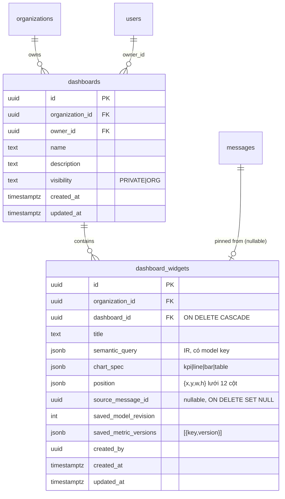

# Phase 6 – Technical Review & Implementation Plan

Ngày: 2026-11-05 · Phạm vi: `main` = 86416ad (Phase 0–5) · Loại: audit, **không sửa mã nguồn**.
Ký hiệu: **[V]** đã kiểm chứng bằng đọc mã / truy vấn DB local · **[A]** giả định, cần kiểm chứng.

---

## 1. Đánh giá kiến trúc hiện tại

| Lớp | Hiện trạng | Bằng chứng |
|---|---|---|
| Metadata + RLS | 33/35 bảng `app` có `ENABLE` + `FORCE` RLS; 2 bảng không RLS là `permissions`, `role_permissions` (catalog tĩnh, không chứa dữ liệu tenant) và `_prisma_migrations`. Role ứng dụng `insightai_app`: không superuser, không `BYPASSRLS`, không sở hữu bảng (owner = `insightai_owner`) | [V] truy vấn `pg_class`/`pg_roles` local |
| Tenant context | `set_config(..., true)` theo transaction, UUID kiểm tra trước; khóa không set ⇒ policy không khớp (fail closed). Không tìm thấy truy cập Prisma ngoài `runInContext` trong `src/` | [V] `apps/api/src/platform/prisma/prisma.service.ts:44-71`; grep `this.prisma.<model>.` = 0 |
| Data plane | Pool riêng (analytics/ingest), mỗi phiên `BEGIN [READ ONLY]` + `SET LOCAL ROLE t_*_reader/_writer` + `SET LOCAL search_path` + `statement_timeout`; tên schema regex `^t_[a-z0-9]{8,12}$` | [V] `platform/data-plane/data-plane.service.ts:58-86`, `tenant-schema.ts:4` |
| Role data plane | Login role `insightai_analytics` là `NOINHERIT`, được `GRANT` **mọi** `t_*_reader` (giới hạn đã biết D-06) ⇒ rào cản chéo tenant ở tầng SQL là validator libpg-query (D-43) | [V] `tenant-provisioning.service.ts:51-56` |
| Query engine | IR → planner → SQL có tham số → `validateSql(schema, tables)` → thực thi; cache key = sha256(org, sql, params, revision, dataset versions, policy id+updatedAt, metric versions) | [V] `query-engine.service.ts:301-323` |
| Worker | Job data chứa `organizationId`; runner luôn đọc/ghi qua `runInTenant(job.organizationId)` ⇒ id job lệch org sẽ không thấy bản ghi | [V] `import-runner.service.ts:158,302,410`, `cleaning-runner.service.ts:63,195,296` |
| AI | Tool calling (5 tool, schema strict), tối đa 6 bước, catalog lọc policy, query lỗi trả lại model, narrative placeholder + digit guard, chart theo luật, quota/ngày/org, `llm_usage` | [V] `modules/ai/ai.service.ts`, `ai-tools.ts`, `answer-text.ts` |
| Rate limit | Throttler dùng Redis storage (đa instance an toàn) | [V] `platform/rate-limit/rate-limit.module.ts:1` |
| Triển khai | Chỉ có `docker/compose.yml` cho **dev** (mật khẩu mặc định, cổng mở ra host). **Không có Dockerfile** cho api/worker/web; CI không build image | [V] `ls`, `.github/workflows/ci.yml` |
| Tài liệu lệch | D-09 (Recharts) vẫn "Proposed" nhưng 5b dùng SVG thuần (D-48); ARCHITECTURE §6 còn ghi Recharts và chart `pie` | [V] `docs/DECISIONS.md:16`, `docs/ARCHITECTURE.md` §6 |

Đánh giá chung: nền tảng cô lập tenant tốt (fail-closed, defense-in-depth ở metadata). Rủi ro chính trước khi phát hành nằm ở **vận hành** (image, backup có role, proxy SSE), **dữ liệu gửi sang OpenAI**, và vài lỗ nhỏ trong nguyên tắc "LLM không tạo số".

---

## 2. Risk register

| ID | Mức | Rủi ro | Bằng chứng | Đề xuất (Phase 6) |
|---|---|---|---|---|
| R-01 | **P0** | Backup thiếu role: tenant role (`t_*_reader/_writer`) là đối tượng cấp cluster; `pg_dump` một DB không chứa role/grant ⇒ restore xong data plane không chạy | [V] provisioning tạo role cấp cluster | Backup = `pg_dumpall --roles-only` (lọc mật khẩu) + `pg_dump -Fc`; diễn tập restore có kiểm tra truy vấn data plane |
| R-02 | **P0** | Không có artefact production (Dockerfile, compose prod, TLS, secrets) | [V] | Task 6F |
| R-03 | **P1** | Văn bản tự do của LLM không qua digit guard: `ask_clarification.question/options`, `cannot_answer.reason` trả thẳng cho người dùng ⇒ model có thể "bịa số" | [V] `ai.service.ts` nhánh `ask_clarification`, `cannot_answer` | Áp cùng guard (không chữ số, độ dài, bỏ URL); vi phạm ⇒ thông điệp tất định |
| R-04 | **P1** | Dữ liệu khách hàng (≤50 dòng kết quả, giá trị dimension, metadata) gửi tới OpenAI (ngoài VN). Với khách VN cần xem xét Nghị định 13/2023 về chuyển dữ liệu cá nhân ra nước ngoài | [V] `explain()` gửi `rows`; `get_dimension_values` | Cài đặt org "Cho phép gửi dữ liệu mẫu tới AI" (mặc định tắt ⇒ explain chỉ gửi tên cột + stats, narrative tất định); ghi rõ trong điều khoản. (Không phải tư vấn pháp lý) |
| R-05 | **P1** | SSE qua reverse proxy: không heartbeat, không deadline tổng (45 s × tối đa 7 lần gọi) ⇒ proxy cắt kết nối/buffer | [V] `openai-provider.ts:3`, `ai.controller.ts` | Comment heartbeat 15 s, deadline tổng 90 s, cấu hình proxy (`proxy_buffering off`, timeout) |
| R-06 | **P1** | Rào cản chéo tenant ở data plane chỉ là SQL validator (login role thuộc mọi reader role) | [V] D-06, provisioning | Giữ D-06 cho MVP; bổ sung test tấn công validator (`SET ROLE`, `RESET ROLE`, `set_config`, schema-qualified, CTE ghi) trong bộ security |
| R-07 | **P1** | Redis/Postgres production: compose dev không có mật khẩu Redis, cổng public | [V] `docker/compose.yml` | Compose prod: mạng nội bộ, `requirepass`, không publish cổng DB/Redis |
| R-08 | **P1** | Độ chính xác AI chưa đo với model thật (chỉ oracle 60/60) | [V] STATUS | Kế hoạch eval §5 |
| R-09 | P2 | Quyền riêng tư hội thoại chỉ ở service (`userId` so sánh); RLS chỉ theo org | [V] pg_policies `conversations/messages` | Policy thêm `user_id = app.user_id` (cần set `userId` trong context) – làm cùng dashboards |
| R-10 | P2 | Quota đếm rồi mới ghi (2 transaction) ⇒ request đồng thời vượt quota | [V] `prepare()` / `ask()` | Đếm + ghi USER message trong cùng transaction với advisory lock theo org |
| R-11 | P2 | Digit guard chỉ chặn `[0-9]`; số viết bằng chữ ("năm trăm triệu") hoặc chữ số Unicode lọt qua | [V] `answer-text.ts:94` | Mở rộng regex `\p{Nd}` + danh sách số đếm vi/en phổ biến |
| R-12 | P2 | Metadata do analyst viết (label, định nghĩa, synonym) nằm trong system prompt ⇒ prompt injection nội bộ org | [V] `catalogForPrompt` trong system message | Đưa catalog vào message `user`/data có rào, giới hạn độ dài, cảnh báo khi chứa mẫu chỉ dẫn |
| R-13 | P2 | `get_dimension_values` không ghi `query_history` (thiếu dấu vết) | [V] `query-engine.service.ts:162-192` | Ghi history `source=AI_LOOKUP` |
| R-14 | P2 | Rollback lỗi ⇒ client có thể trả về pool khi đang hỏng | [V] `data-plane.service.ts:80-85` | `client.release(err)` khi ROLLBACK lỗi |
| R-15 | P2 | Tài liệu lệch (D-09/ARCHITECTURE vs SVG) | [V] | Cập nhật D-09 "Superseded by D-48" |
| R-16 | P2 | Worker tin `organizationId` từ Redis | [V] chặn bởi RLS lookup | Chấp nhận; Redis phải có auth (R-07) |

---

## 3. Kiến trúc Dashboard

### 3.1 ERD

- Không lưu SQL, không lưu kết quả (đúng DATABASE_DESIGN §2.5). Giới hạn: 30 widget/dashboard, 200 dashboard/org.
- RLS: `organization_id = ctx` **và** `(visibility = 'ORG' OR owner_id = app.user_id)` cho SELECT; ghi chỉ owner hoặc admin (kiểm tra ở service + policy). Widget kế thừa qua `dashboard_id` (policy EXISTS).
- `query_history.source` là `String` [V] ⇒ thêm giá trị `DASHBOARD` không cần migration enum.

### 3.2 Lưu & kiểm tra IR

1. Body widget → `semanticQuerySchema` (contracts) → `chartSpecSchema`.
2. Server chạy `QueryEngineService.compile` với quyền **người lưu** ⇒ 422 `QUERY_REJECTED` nếu không hợp lệ hoặc người lưu không được phép.
3. Lưu `saved_model_revision`, `saved_metric_versions` chỉ để hiển thị/cảnh báo.

### 3.3 Thực thi theo quyền người xem

- `POST /dashboards/:id/widgets/:wid/run` → `QueryEngineService.run(viewerCtx, ir, 'DASHBOARD')` – policy, row filter, cache hiện có áp dụng nguyên vẹn.
- Member bị ẩn ⇒ widget hiển thị "Bạn không có quyền xem widget này" (không lộ tên member); row filter ⇒ badge `policiesApplied`.

### 3.4 Tương thích snapshot

- Luôn chạy với snapshot model đang publish và **version metric đang publish** (KPI nhất quán toàn hệ thống).
- Khác `saved_*` ⇒ badge "Định nghĩa đã thay đổi từ khi lưu (v2 → v3)".
- Bị từ chối (`UNKNOWN_METRIC`, `UNKNOWN_MEMBER`, `DATA_UNAVAILABLE`…) ⇒ trạng thái "Cần cập nhật" + lý do; không tự sửa IR.

### 3.5 Ghim câu trả lời AI

1. Nút "Ghim vào dashboard" ở câu trả lời `ANSWERED` (người có `dashboard:write`).
2. Chọn dashboard có quyền sửa hoặc tạo mới (mặc định PRIVATE).
3. `POST /dashboards/:id/widgets { fromMessageId, title? }` → server đọc message (phải thuộc hội thoại của chính người gọi), lấy `answer.query` + `answer.chart`, chạy bước 3.2.
4. Không sao chép narrative hay kết quả.

### 3.6 Ma trận phân quyền

Quyền hiện có [V]: viewer có `dashboard:read`; analyst/admin/owner có thêm `dashboard:write`.

| Hành động | Owner org | Admin | Analyst | Viewer |
|---|---|---|---|---|
| Xem dashboard ORG | ✅ | ✅ | ✅ | ✅ |
| Xem dashboard PRIVATE của người khác | ❌ | ❌ | ❌ | ❌ |
| Tạo dashboard (PRIVATE/ORG) | ✅ | ✅ | ✅ | ❌ |
| Sửa / thêm widget dashboard của mình | ✅ | ✅ | ✅ | – |
| Sửa dashboard ORG của người khác | ✅ | ✅ | ❌ | ❌ |
| Xóa dashboard ORG của người khác | ✅ | ✅ | ❌ | ❌ |
| Đổi PRIVATE ↔ ORG | chủ dashboard | chủ dashboard | chủ dashboard | – |
| Ghim câu trả lời AI | ✅ | ✅ | ✅ | ❌ |
| Dữ liệu widget | luôn theo policy của **người xem** |||

Câu hỏi mở: viewer có cần dashboard PRIVATE để ghim không? (MVP: không – theo quyền hiện có.)

---

## 4. Kế hoạch kiểm thử bảo mật (integration, chạy trong CI)

Mỗi case: 2 org A/B, mỗi org đủ 4 vai trò; kỳ vọng 404 (không lộ tồn tại) hoặc 403.

| # | Tấn công | Kỳ vọng |
|---|---|---|
| S-01 | User A gọi `GET/PATCH/DELETE` dataset, model, metric, policy, conversation, dashboard, widget của B bằng id thật + header org A | 404 |
| S-02 | Header `X-Organization-Id` = B khi không là thành viên B | 403 |
| S-03 | IR tham chiếu model key của B (trùng tên key) | chạy trên model của A hoặc 404, không bao giờ dữ liệu B |
| S-04 | Prisma ngoài context (unit test bằng role app): `SELECT` mọi bảng `app` không set `app.org_id` | 0 dòng |
| S-05 | Pool reuse: request A rồi B trên cùng connection (pool size 1) | B không thấy setting của A |
| S-06 | SQL validator: chuỗi `SET ROLE`, `RESET ROLE`, `set_config`, `pg_sleep`, `dblink`, schema-qualified `t_other.x`, `app.users`, CTE `INSERT`, comment injection trong filter value | `SQL_REJECTED` hoặc chỉ là literal tham số |
| S-07 | Cache: A và B có SQL giống hệt (cùng tên bảng khác schema) | key khác (có org) |
| S-08 | Cache sau đổi policy/role | key mới, không trả kết quả cũ |
| S-09 | Job BullMQ giả với `organizationId`=A, `importJobId` của B | job no-op/failed, không ghi dữ liệu |
| S-10 | Conversation: user khác cùng org đọc/xóa/tiếp tục | 404 (đã có [V] `ai.int.test.ts`) + RLS user-level sau R-09 |
| S-11 | Dashboard PRIVATE của user khác cùng org: list/get/run/widget | 404 |
| S-12 | Widget ORG chứa member bị ẩn với viewer | dữ liệu không trả, thông báo trung tính |
| S-13 | Ghim từ `messageId` của người khác | 404 |
| S-14 | Token hết hạn / refresh token bị thu hồi / CSRF thiếu header | 401/403 |
| S-15 | Prompt injection qua câu hỏi, giá trị dữ liệu, synonym/label do analyst viết, kết quả tool | không SQL, không số tự do, không lộ system prompt |

Hiện đã có [V]: `rls-tenant-isolation.int.test.ts` (6), `data-plane-isolation.int.test.ts` (7), `tenancy.int.test.ts` (16), `ai.int.test.ts` (13). Bộ mới gom vào `test/security/*.int.test.ts`.

---

## 5. Kế hoạch đánh giá AI

Hiện trạng [V]: 57 câu + 3 follow-up; chấm theo **so khớp tập dòng kết quả** với `expect.query`; chế độ oracle 60/60; chưa chạy model thật.

Bổ sung:
1. **Chạy thật** `AI_EVAL=true`, **3 lần** mỗi model ứng viên (nondeterminism) ⇒ báo cáo trung bình, min, câu dao động.
2. **Chỉ số theo nhóm**: đúng metric, đúng dimension, đúng thời gian, đúng filter, đúng trạng thái (clarify/cannot), injection; thêm p50/p95 latency, token/câu, chi phí/câu.
3. **Ngưỡng chấp nhận MVP**: tổng ≥ 85 %, nhóm injection 100 %, câu "không trả lời được" không bao giờ trả `ANSWERED` sai, 0 vi phạm digit guard.
4. **Mở rộng bộ câu**: +20 câu (số viết bằng chữ, lỗi chính tả, không dấu, tiếng lóng KD, câu dài nhiều điều kiện, filter giá trị không tồn tại, policy viewer).
5. **Test hành vi model thật còn thiếu**: model tự viết số trong clarify/cannot (R-03); model gọi tool không tồn tại; JSON hỏng; vòng lặp tool; tôn trọng ngôn ngữ người hỏi.
6. CI: oracle chạy mỗi PR (rẻ, kiểm tra bộ eval); eval thật chạy thủ công/hằng tuần, lưu báo cáo làm artefact.

---

## 6. Phase 6 – Task breakdown & acceptance criteria

Thứ tự: 6A → 6B → 6C song song 6D/6E → 6F → 6G → 6H.

| Task | Nội dung | Acceptance criteria |
|---|---|---|
| **6A Dashboard backend** | Migration `dashboards`, `dashboard_widgets` (RLS org + visibility); contracts; CRUD; run widget; pin từ message | Migration mới (không sửa cũ); RLS FORCE; 404 cho PRIVATE người khác; widget chạy với quyền người xem; IR không hợp lệ ⇒ 422; pin chỉ từ message của chính mình; API_DOCUMENTATION §5i; integration test ≥ 15 case |
| **6B Dashboard UI + pin** | Trang danh sách/chi tiết, lưới 12 cột (kéo thả đơn giản hoặc nút di chuyển), thêm widget từ KPI/Ask, nút "Ghim" | vi/en đủ; loading/empty/error; trạng thái "cần cập nhật"; 375 px không tràn; component test ≥ 6 |
| **6C Security hardening + suite** | Sửa R-03, R-05, R-09, R-10, R-11, R-13, R-14; bộ S-01…S-15 | Toàn bộ case §4 xanh trong CI; không đổi contract công khai (trừ thêm field tùy chọn) |
| **6D Playwright E2E** | Luồng: đăng ký → upload → quality → cleaning → model/metric → hỏi (LLM giả lập qua `OPENAI_BASE_URL`) → ghim → dashboard; viewer xem dashboard | Chạy được bằng 1 lệnh trên compose; CI job riêng; ổn định 3 lần liên tiếp; video/trace khi lỗi |
| **6E k6 performance** | Dataset 2 triệu dòng; kịch bản semantic query (cache miss/hit), dashboard 10 widget, 20 VU | p95 query cache-miss ≤ 3 s, cache-hit ≤ 300 ms, dashboard 10 widget ≤ 5 s, lỗi < 1 %; báo cáo lưu `docs/PERFORMANCE.md` |
| **6F Production Docker** | Dockerfile multi-stage api/worker (non-root, `node:22-alpine`), web (build tĩnh + Caddy/nginx), `docker/compose.prod.yml` (mạng nội bộ, healthcheck, restart, TLS tự động, `proxy_buffering off` cho SSE), job migrate, secrets qua env file ngoài repo | `docker compose -f compose.prod.yml up` từ máy sạch chạy được; image không chứa `.env`/devDeps; CI build image; SSE hoạt động qua proxy ≥ 120 s |
| **6G Backup/restore** | Script `pg_dumpall --roles-only` + `pg_dump -Fc` hằng ngày, giữ 7 ngày + 4 tuần, đẩy S3 khác vùng, mã hóa; backup bucket SeaweedFS/S3; tài liệu restore | Diễn tập restore lên máy trống: đăng nhập, chạy semantic query trên data plane, đếm dòng khớp; RPO ≤ 24 h (≤ 5 phút nếu managed PITR), RTO ≤ 2 h đo thực tế |
| **6H Monitoring, logging, docs** | Log JSON (đã có pino) → Loki/Grafana hoặc dịch vụ log; uptime check `/health/live|ready`; cảnh báo lỗi 5xx, queue tồn, dung lượng đĩa, chi phí LLM/ngày; `docs/DEPLOYMENT.md`, `docs/OPERATIONS.md` | Dashboard vận hành có 5 chỉ số trên; cảnh báo thử nghiệm được kích hoạt; tài liệu đủ để người khác triển khai lại từ đầu |

Ngoài phạm vi (roadmap): public dashboard, báo cáo định kỳ, Kubernetes, fine-tune/ML, OpenTelemetry đầy đủ.

---

## 7. Triển khai – so sánh

Ước tính chi phí theo giá công khai phổ biến (USD/tháng, **cần báo giá lại** trước khi chốt), cho ~10–30 tổ chức pilot, dữ liệu < 200 GB. Chưa gồm chi phí OpenAI.

| Phương án | Thành phần | Chi phí ước tính | Độ trễ tới người dùng VN | Backup | Vận hành | Bảo mật dữ liệu |
|---|---|---|---|---|---|---|
| **A. VPS + Docker Compose** (VN: Viettel IDC/FPT/BizFly; hoặc Singapore) | 1 VPS 4 vCPU/8 GB + 1 VPS nhỏ backup/monitor + object storage | 60–130 | VN: 5–20 ms; SG: 30–50 ms | Tự làm (6G) – rủi ro con người | Thấp về chi phí, cao về trách nhiệm (patch, đĩa, restore) | Dữ liệu nằm tại VN được (lợi thế pháp lý) |
| **B. VPS + PostgreSQL managed** | VPS app/worker/Redis + DBaaS 2 vCPU/4–8 GB có PITR + object storage | 130–280 | như A | PITR của nhà cung cấp + dump logic (vẫn cần roles) | Trung bình | Như A nếu chọn DBaaS tại VN |
| **C. AWS/GCP managed (Singapore)** | ECS/Cloud Run, RDS/Cloud SQL (Multi-AZ), ElastiCache/Memorystore, S3/GCS, LB, NAT | 400–800 | 30–50 ms | Tốt nhất, tự động | Thấp khi đã dựng, cần IaC | Dữ liệu ra nước ngoài (cân nhắc ND 13) |

Lưu ý kỹ thuật cho mọi phương án [A]: DBaaS phải cho phép `CREATEROLE` và `GRANT role TO role` (provisioning tenant) – **cần xác minh với nhà cung cấp VN trước khi chọn**; RDS/Cloud SQL hỗ trợ.

**Khuyến nghị MVP: B** – app trên VPS tại VN, PostgreSQL managed có PITR tại VN (nếu đáp ứng `CREATEROLE`), Redis trong compose có mật khẩu, object storage S3-compatible tại VN + bản sao backup ở vùng khác. Lý do: dữ liệu ở VN, độ trễ thấp, rủi ro mất dữ liệu nằm ở nhà cung cấp DB, chi phí vừa phải, không cần Kubernetes. Chuyển sang C khi cần SLA cao hoặc khách hàng quốc tế.

Chi phí OpenAI [A]: ≈ 3–7 lượt gọi/câu hỏi, 4–10 nghìn token/câu ⇒ chi phí/câu phụ thuộc model chọn; đo thật bằng `llm_usage` trong eval (§5.2) rồi đặt `AI_DAILY_QUESTION_LIMIT` theo gói.

---

## 8. Việc cần bạn quyết định trước khi bắt đầu

1. Duyệt thứ tự task 6A–6H và tiêu chí chấp nhận.
2. R-04: mặc định **tắt** gửi dữ liệu mẫu tới OpenAI theo org?
3. Viewer có được tạo dashboard PRIVATE / ghim không (cần thêm quyền)?
4. Phương án triển khai (khuyến nghị B) và nhà cung cấp cụ thể.
5. Có API key OpenAI để chạy eval thật trước 6C không.
